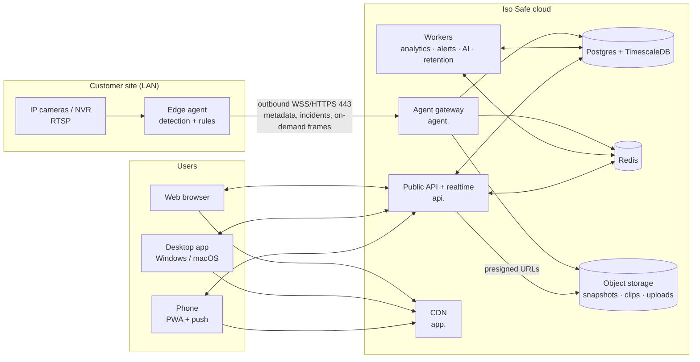
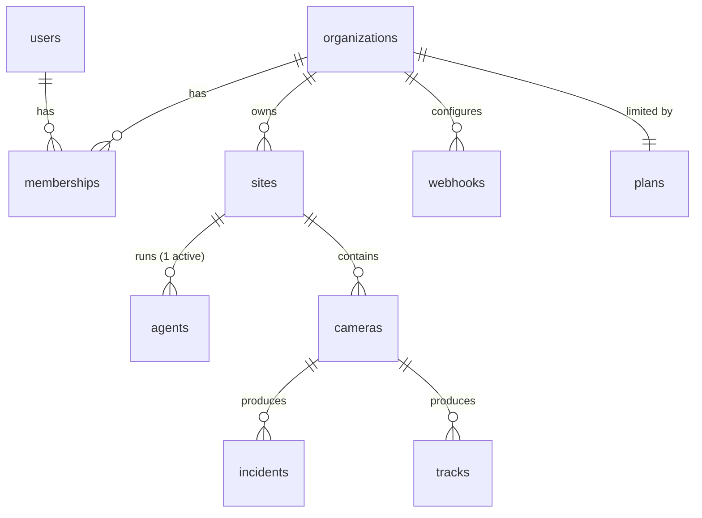

# Iso Safe PRD: v2.0 Cloud Platform (Developer Edition)

**Oct 7, 2026 · @Fimber · Status: Draft for engineering kickoff**

This is the build spec for the incoming backend engineer. It describes what you
are building, in what order, and how we will know it is done. It assumes you
have read the current-state technical docs in [`docs/`](README.md), especially
[Architecture](architecture.md), [Pipeline](pipeline.md) and
[Known issues](known-issues.md).

**Relationship to other documents**

| Document | Role |
|---|---|
| [PRD MVP v1.0 (Developer Edition)](PRD-MVP-v1-Developer-Edition.md) | What exists today: a single-tenant Docker stack per site. Its §9 "out of scope" items (multi-tenancy, edge connector, installed clients) are **in scope here**. |
| This document | v2.0: turn Iso Safe into a hosted, multi-customer cloud product used from a website and an installed desktop app. |
| `docs/*.md` technical docs | How the current code works. Update them as you change the system. |

---

## 0. Summary: what you are building

Today Iso Safe runs as one Docker Compose stack on one machine, reachable only
on that network, serving one organization. v2.0 turns it into a **cloud
platform**:

1. **A multi-tenant cloud backend** (API, realtime, workers, database, object
   storage) hosted on a public domain, where many customer organizations, each
   with many users and many sites, sign in from anywhere.
2. **An edge agent**: the existing detection pipeline, repackaged as software
   that runs on a small computer at each customer site, reads the local cameras,
   runs detection and rules on site, and connects **outbound** to the cloud. No
   VPN, no port forwarding.
3. **Clients**: the existing React web app, made multi-tenant and hosted on a
   CDN; an installable **desktop app** for Windows and macOS; and an installable
   **mobile web app (PWA)** with push notifications.
4. **Production operations**: infrastructure as code, CI/CD, staging and
   production environments, monitoring, backups, security hardening.



**The one-sentence rule:** video is processed at the edge; the cloud stores
metadata, incidents and their snapshots, and relays live frames only while
someone is watching.

---

## 1. Background and current state

### 1.1 What exists (do not throw away)

The v1 codebase is a working product. Reuse it:

| Component | Current code | v2.0 fate |
|---|---|---|
| Stream readers, drop-oldest queues | `backend/app/ingestion/` | Moves into the edge agent unchanged |
| YOLO worker pool, tracker, OCR | `backend/app/inference/` | Moves into the edge agent |
| Rule engine, zones, profiles | `backend/app/rules/`, `backend/app/profiles/` | Rule engine runs in the agent; profiles are used by the cloud API to seed rules |
| Pipeline orchestrator | `backend/app/pipeline/` | Becomes the agent's core; reconcile-from-DB becomes sync-from-cloud |
| REST API, auth, RBAC, audit | `backend/app/api/`, `security.py` | Stays in the cloud; becomes multi-tenant |
| WebSocket fan-out via Redis | `backend/app/ws/` | Stays in the cloud; becomes tenant-scoped |
| Analytics, reports, AI search, insights | `backend/app/analytics/`, `api/reports.py`, `search/` | Stays in the cloud; reworked for the new data model and tenancy |
| React SPA | `frontend/` | Extended for tenancy, onboarding, notifications; wrapped by the desktop app |
| Docker Compose stack | `docker-compose.yml` | Kept as the **local development** environment |

### 1.2 Why the current design can't simply be "put on a server"

| Problem | Consequence |
|---|---|
| Cameras sit on private customer networks behind NAT | A cloud server cannot open `rtsp://192.168.x.x`. Something on site must reach the cameras. |
| Continuous video upload costs ~2–8 Mbit/s per camera | 30 cameras streamed 24/7 to the cloud saturates most business uplinks and costs a lot in cloud GPU and egress. |
| One organization per deployment | No organizations, no tenant isolation; every WebSocket client receives every incident. |
| Per-frame detection rows | ~1 row per object per processed frame (tens of millions/day per site). Fine on a local disk, very expensive in a managed cloud database. |
| Public, unauthenticated `/media/` | Snapshots would be exposed on the internet. |
| Single-process pipeline + in-memory state | No horizontal scaling; cannot run on stateless cloud containers. |

Hence the edge + cloud split (§3).

### 1.3 Known issues that block production

All are listed in [known-issues.md](known-issues.md). Phase 0 (§10) fixes the
ones that survive into v2.0.

---

## 2. Goals, non-goals, success metrics

### 2.1 Goals

| ID | Goal |
|---|---|
| G1 | A customer can sign up (or be invited), create an organization, add a site, install the edge agent, add cameras, and see live detections and alerts in the browser **without any networking changes at the site**. |
| G2 | Many organizations share the platform with **strict data isolation**. |
| G3 | Users access Iso Safe from any browser, an installed desktop app (Windows/macOS), or their phone (PWA), and receive alerts in near real time on all of them. |
| G4 | The platform runs in production with staging, CI/CD, monitoring, backups, and documented runbooks, so it can be operated by someone other than the original developer. |
| G5 | Every v1 capability (cameras, zones, 8 rule types, 14 profiles, incidents, analytics, reports, investigations, LPR, AI assistant) keeps working in the cloud product. |

### 2.2 Non-goals for v2.0

- Native iOS/Android apps (the PWA covers mobile; native is v2.x).
- Billing and payments (plan limits exist, but are set manually by platform staff).
- SSO/SAML/SCIM (design for it; build in v2.1).
- Continuous recording / VMS replacement / long video archives.
- Certified ANPR, speed enforcement.
- Multi-region active-active deployment.
- Kubernetes (use managed containers; see §8).

### 2.3 Success metrics (launch targets; owner to confirm in D-09)

| Metric | Target |
|---|---|
| Time from new org to first live camera, for a trained installer | ≤ 30 minutes |
| Alert latency: rule fires at the edge → visible in web/desktop | p95 ≤ 2 s |
| Alert latency → push notification on phone | p95 ≤ 10 s |
| Live view start (click → first frame) | p95 ≤ 3 s |
| Cloud API/dashboard availability | ≥ 99.5 % monthly |
| Cross-tenant data leaks | 0 (automated tests + pen test) |
| Data loss when a site's internet drops for ≤ 72 h | 0 incidents lost, metadata backfilled |

---

## 3. Target architecture

### 3.1 Components

| Component | Runs where | Responsibility | Built from |
|---|---|---|---|
| **Edge agent** | Customer site, Linux + Docker | Camera ingest, YOLO, tracking, OCR, rule evaluation, snapshot capture, local buffering, outbound sync with cloud, live-frame relay on demand, ONVIF discovery | `backend/app/{ingestion,inference,pipeline,rules}` |
| **Agent gateway** | Cloud, `agent.<domain>` | Authenticates agents, holds their persistent WSS control connections, receives batched uploads, issues presigned snapshot uploads, relays live frames to Redis | New FastAPI service |
| **Public API** | Cloud, `api.<domain>` | REST for all clients, tenant-scoped auth/RBAC, presigned media URLs, user WebSocket realtime | `backend/app/api`, `backend/app/ws` |
| **Workers** | Cloud | Analytics rollups, alert dispatch (email, web push, webhooks), AI insights, retention, report generation; exactly-once scheduling via leader lock | `backend/app/analytics`, `alerts`, `search` |
| **Hosted agent** (Phase 3) | Cloud GPU | The same agent software run by us, for uploaded videos and internet-reachable cameras | Edge agent image |
| **Postgres + TimescaleDB** | Managed | System of record, tenant isolation via `org_id` + row-level security | Alembic migrations |
| **Redis** | Managed | Pub/sub between gateway, API and workers; live state; rate limits; locks | — |
| **Object storage** | Managed (S3-compatible) | Snapshots, clips, uploads, report files, heatmaps; private bucket, presigned URLs only | — |
| **Web app** | CDN, `app.<domain>` | React SPA | `frontend/` |
| **Desktop app** | User PCs | Signed Windows/macOS installer wrapping the SPA with native notifications, tray, auto-update | New `desktop/` |

### 3.2 Data flows

**Normal operation**

1. Admin configures cameras, zones and rules in the web app. The API stores them
   and pushes a `config.update` to the site's agent over its control connection.
2. The agent runs the v1 pipeline locally. For every **finished or long-running
   track** it emits a track summary; every minute it emits per-camera,
   per-zone stats (§6.3). It does **not** upload per-frame detections.
3. When a rule fires, the agent creates the incident locally (with a UUID),
   captures the annotated snapshot, sends the incident to the gateway, and
   uploads the snapshot to object storage through a presigned URL.
4. The gateway writes the incident, then publishes it to Redis on the
   **organization's** channel. API instances push it to that org's connected
   users; workers send email, web push and webhooks according to org/user
   preferences.

**Live view (on demand)**

1. A user opens a camera tile. The client subscribes over its WebSocket.
2. The API registers the viewer and asks the gateway to send `live.start` to the
   agent.
3. The agent sends annotated JPEG frames (≤ `DASHBOARD_MAX_FPS`, ≤ 960 px) as
   binary messages on its control connection. The gateway publishes them to
   Redis; API instances forward them to subscribed users of that org only.
4. 30 s after the last viewer leaves, the API sends `live.stop`. No frames are
   stored.

**Site goes offline**

The agent keeps detecting and evaluating rules. Tracks, stats, incidents and
snapshots are written to a local durable queue (SQLite + files). On reconnect
the agent replays in order; the cloud deduplicates by UUID. The cloud marks the
site **offline** after 90 s without a heartbeat and raises a `site_offline`
system incident for the org.

### 3.3 Architecture decisions (locked unless the owner changes them in §15)

| ID | Decision | Rationale |
|---|---|---|
| ADR-01 | Inference runs at the edge by default; cloud inference only for uploads and internet-reachable cameras (Phase 3). | Cameras are behind NAT; bandwidth and GPU cost; latency; privacy. |
| ADR-02 | The agent connects outbound only, over TLS on port 443. | Works through any firewall without customer IT changes. |
| ADR-03 | Shared database, shared schema, `org_id` on every tenant row, enforced in application code **and** Postgres row-level security. | Simplest to operate at our scale; RLS gives defence in depth. |
| ADR-04 | Track summaries + minute stats replace per-frame detections in the cloud. | Reduces cloud rows by ~100×, and fixes the broken hourly-analytics SQL in passing. |
| ADR-05 | All media lives in a private object-storage bucket and is served via short-lived presigned URLs. | Fixes unauthenticated `/media/`. |
| ADR-06 | Managed containers (e.g. AWS ECS Fargate) plus managed Postgres/Redis, with Terraform for infrastructure. No Kubernetes in v2.0. | Lowest operational burden for a one-person team. |
| ADR-07 | One codebase, two deployables from the Python side: `cloud` (API, gateway, workers; no torch) and `agent` (pipeline; with torch). Shared logic lives in a common package. | Avoids forking the rule engine and tracker. |
| ADR-08 | Desktop app is a thin native shell around the same React SPA. | One UI codebase. |

---

## 4. Tenancy, identity and access

### 4.1 Hierarchy



| Entity | Notes |
|---|---|
| Organization | A customer company. Has a plan (limits), settings (AI opt-in, retention), and a timezone default. |
| Site | A physical location: name, address, **IANA timezone** (fixes UTC schedules), one active agent. |
| Agent | An installed edge agent bound to one site; has credentials, version, status. |
| Camera | Belongs to one site. Same fields as v1 plus `site_id`, `org_id`. |
| User | A person, identified by email; can belong to several organizations. |
| Membership | (user, org, role, optional site scope). |

### 4.2 Roles

| Role | Scope | Can |
|---|---|---|
| `owner` | org | Everything an admin can, plus manage billing/plan contact, delete the org, transfer ownership. At least one per org (enforced). |
| `admin` | org | Manage sites, agents, cameras, zones, rules, users, webhooks, org settings. |
| `operator` | org or selected sites | v1 operator: triage incidents, uploads (Phase 3). |
| `viewer` | org or selected sites | v1 viewer: read-only. |
| `platform_admin` | whole platform (our staff) | Create orgs, set plan limits, view health, impersonate (audited, time-limited, visible to the org). Not assignable by customers. |

Site scoping: if a membership lists site ids, every query for that user is
filtered to those sites (cameras, incidents, tracks, analytics, live view,
alerts).

### 4.3 Enforcement (non-negotiable)

1. Every tenant table has `org_id NOT NULL` (and `site_id` where applicable),
   indexed.
2. Every request resolves `(user, org, role, site_scope)` from the access token
   and checks membership **in the database** (cache ≤ 60 s).
3. Every query filters on `org_id` through a single helper/dependency. No raw
   query may skip it (enforce through code review and a lint/test).
4. Postgres **row-level security** on every tenant table, using
   `current_setting('app.org_id')` set per transaction. The application role
   is not a superuser and does not bypass RLS.
5. Redis channels are org-scoped: `org:{org_id}:alerts`,
   `org:{org_id}:frames:{camera_id}`, `org:{org_id}:counts`.
6. Object keys are prefixed `orgs/{org_id}/...`; presigned URLs are only issued
   after an authorization check.
7. A **tenant-isolation test suite** (two orgs, every endpoint, every WS message
   type, every media URL) runs in CI and must pass for every merge.

---

## 5. Functional requirements

Priorities: **P0** must ship for the phase to be accepted, **P1** should ship in
v2.0, **P2** nice to have. The phase is the earliest one it belongs to (§10).
Requirement IDs are stable; reference them in tickets, branches and commits.

### 5.1 Tenancy and organization management

| ID | Requirement | P | Phase |
|---|---|---|---|
| CLD-FR-001 | Organizations, sites, memberships, plans as in §4, with migrations from the v1 schema. | P0 | 1 |
| CLD-FR-002 | Org settings: name, logo, default timezone, AI features opt-in (off by default), retention overrides within plan limits. | P0 | 1 |
| CLD-FR-003 | Site CRUD (name, address, timezone). Deleting a site requires no cameras or a confirmed cascade. | P0 | 1 |
| CLD-FR-004 | Plan limits enforced server-side: max sites, max cameras, max users, retention days, AI enabled, cloud inference minutes. Exceeding returns 402/409 with a clear message. | P0 | 1 |
| CLD-FR-005 | Org switcher for users in several orgs. | P0 | 1 |
| CLD-FR-006 | Platform admin console (API + minimal UI): list orgs, create org + owner invite, edit plan limits, suspend org, view agent/site health across the platform. | P0 | 1 |
| CLD-FR-007 | Audited, time-limited impersonation for support, with a banner visible to the org's admins and an audit entry. | P1 | 2 |
| CLD-FR-008 | Self-service sign-up creating a trial org (behind a feature flag, default off). | P2 | 2 |
| CLD-FR-009 | Data export for an org (incidents, tracks, analytics as CSV/JSON + snapshots zip) and org deletion with full purge (DB rows + object storage). | P1 | 2 |

### 5.2 Authentication and accounts

| ID | Requirement | P | Phase |
|---|---|---|---|
| CLD-FR-020 | Email + password login (bcrypt or argon2id), generic error messages, account lockout/backoff after repeated failures **per account and per real client IP**. | P0 | 1 |
| CLD-FR-021 | Short-lived access token (≤ 15 min) carrying `user_id`, `org_id`, `role`; server-side **sessions** table for refresh tokens with rotation and reuse detection. Logout and admin "revoke sessions" invalidate immediately. | P0 | 1 |
| CLD-FR-022 | Web: refresh token in an `HttpOnly; Secure; SameSite` cookie, access token in memory only (no `localStorage`). Desktop: tokens in the OS keychain. | P0 | 1 |
| CLD-FR-023 | Invitations by email with role and optional site scope; invite links expire after 7 days. | P0 | 1 |
| CLD-FR-024 | Email verification and password reset via single-use, expiring links. | P0 | 1 |
| CLD-FR-025 | TOTP multi-factor auth; **required for owner, admin and platform_admin**, optional for others; recovery codes. | P0 | 1 |
| CLD-FR-026 | User profile: name, password change, MFA management, active sessions list with revoke, notification preferences. | P1 | 1 |
| CLD-FR-027 | Remove the bootstrap-admin-from-env mechanism in cloud mode; the first platform admin is created by a one-off CLI command. | P0 | 1 |
| CLD-FR-028 | OIDC SSO (Google Workspace, Microsoft Entra) per org. Design data model now; build in v2.1. | P2 | — |

### 5.3 Edge agent

| ID | Requirement | P | Phase |
|---|---|---|---|
| CLD-FR-040 | Agent packaged as a versioned, signed Docker image (CPU and NVIDIA CUDA variants) plus a one-line installer script for Ubuntu 22.04/24.04 LTS. | P0 | 1 |
| CLD-FR-041 | **Pairing:** an admin creates an agent for a site in the web app and gets a one-time pairing code (valid 24 h). The installer runs `isosafe-agent pair <code>`; the agent receives its identity and credential. No credentials typed by hand. | P0 | 1 |
| CLD-FR-042 | Persistent outbound WSS control connection to the gateway with heartbeat every 30 s and exponential reconnect (1 s → 60 s, jittered). | P0 | 1 |
| CLD-FR-043 | Config sync: on connect and on every change, the agent receives its cameras (with decrypted sources), zones, rules, site timezone and pipeline settings; acknowledges with a config version. Replaces the 15-second DB reconcile loop. Changes to **any** camera field take effect (fixes source changes not hot-reloading). | P0 | 1 |
| CLD-FR-044 | Runs the v1 pipeline: readers, YOLO pool, tracker, OCR, rule engine. Rule schedules are evaluated in the **site timezone**. | P0 | 1 |
| CLD-FR-045 | Uploads track summaries, minute stats, incidents, camera health, agent health in batches over HTTPS (§7.3), compressed, idempotent. | P0 | 1 |
| CLD-FR-046 | Snapshots: annotated JPEG uploaded straight to object storage via a presigned PUT obtained from the gateway. | P0 | 1 |
| CLD-FR-047 | **Store-and-forward:** durable local queue (SQLite + files) for all outbound data; survives agent restarts; capacity configurable (default 72 h or 20 GB); replays oldest-first; drops oldest only when full, and reports drops. | P0 | 1 |
| CLD-FR-048 | Live frames on demand (`live.start`/`live.stop`), annotated, rate-capped, sent as binary WS messages. Fix the v1 throttle bug so annotated frames are actually delivered, including for file sources. | P0 | 1 |
| CLD-FR-049 | Remote ONVIF discovery and stream-URI lookup executed **on the agent** (it is on the camera LAN), results returned to the web UI; "Use" fills a real RTSP URI. | P1 | 1 |
| CLD-FR-050 | Remote commands: restart pipeline, snapshot now, test camera connection (returns success/error/resolution/FPS), fetch recent agent logs (last 1,000 lines, redacted). | P1 | 2 |
| CLD-FR-051 | Version reporting and **remote update**: cloud sets the desired version per agent or org; the agent pulls the signed image and restarts itself; automatic rollback if it fails to reconnect within 5 min. | P1 | 2 |
| CLD-FR-052 | Local resource guards from v1 (memory recycle, disk guard) kept; guard events become `system_health` incidents **persisted** in the cloud. | P0 | 1 |
| CLD-FR-053 | Agent exposes a local status page / CLI (`isosafe-agent status`) showing connection state, cameras, queue depth, version, for installers on site. | P1 | 1 |
| CLD-FR-054 | Incident clips: a per-camera ring buffer keeps the last N seconds of encoded video; on incident, upload a 10 s clip (5 s before, 5 s after) alongside the snapshot (`incidents.clip_path`). | P2 | 3 |
| CLD-FR-055 | Hardware support matrix documented and tested: x86-64 CPU-only, x86-64 + NVIDIA GPU. NVIDIA Jetson is P2. | P0 | 1 |

### 5.4 Cameras, zones, rules

| ID | Requirement | P | Phase |
|---|---|---|---|
| CLD-FR-060 | Camera CRUD scoped to a site; limits enforced per plan. All v1 fields kept. | P0 | 1 |
| CLD-FR-061 | Camera sources encrypted at rest with a per-org data key (envelope encryption via the cloud KMS); decrypted only to send to that site's agent over the authenticated TLS channel; never returned to clients (redacted, including credentials in query strings). | P0 | 1 |
| CLD-FR-062 | Zones and rules as in v1 (JSON), validated with a JSON schema on write (rule type, severity, numeric ranges, schedule format, zone references). Invalid rules return 422 instead of failing at runtime. | P0 | 1 |
| CLD-FR-063 | All 14 vertical profiles; applying or re-applying a profile on an existing camera merges rules with a preview. | P1 | 1 |
| CLD-FR-064 | Live camera status in the cloud: online/offline, FPS, reconnects, dropped frames, last frame time (from agent health), plus site/agent online state. | P0 | 1 |
| CLD-FR-065 | Zone editor uses a fresh snapshot fetched from the agent when no live stream is running. | P1 | 1 |

### 5.5 Incidents and alerting

| ID | Requirement | P | Phase |
|---|---|---|---|
| CLD-FR-080 | Incidents as in v1 plus `org_id`, `site_id`, agent-generated `uuid` (idempotency), `snapshot_key`, `clip_key`. Same status workflow and transitions. | P0 | 1 |
| CLD-FR-081 | Incident comments/activity timeline (status changes, assignment, notes, who/when) instead of one notes field. | P1 | 2 |
| CLD-FR-082 | Realtime incident delivery to that org's connected users only (respecting site scope). | P0 | 1 |
| CLD-FR-083 | Notification preferences per user: channels (in-app, email, push, desktop), minimum severity, sites, quiet hours. Org-level defaults. | P0 | 2 |
| CLD-FR-084 | Email through a transactional provider with SPF/DKIM on our sending domain; includes a link to the incident and a thumbnail via a short-lived URL. | P0 | 1 |
| CLD-FR-085 | Web Push (VAPID) to installed PWAs and browsers. | P0 | 2 |
| CLD-FR-086 | Per-org webhooks (multiple endpoints, event filters, HMAC signature with per-endpoint secret, timestamp header to prevent replay), with **retries** (exponential, 24 h) and a delivery log. | P1 | 2 |
| CLD-FR-087 | System incidents per org: `site_offline`, `camera_offline` (> 5 min), `agent_disk_low`, `agent_memory_recycle`, `agent_queue_dropping`, persisted and routed like rule incidents. | P0 | 1 |
| CLD-FR-088 | Alert storms: if a camera fires more than N incidents of a type in M minutes, group notifications into one digest while still recording every incident. | P1 | 2 |

### 5.6 Analytics, investigations, reports

| ID | Requirement | P | Phase |
|---|---|---|---|
| CLD-FR-100 | Cloud data model of tracks + minute stats (§6.3), replacing per-frame detections. | P0 | 1 |
| CLD-FR-101 | Hourly/daily analytics recomputed from minute stats and tracks (TimescaleDB continuous aggregates preferred), filterable by org, site, camera, zone; all day boundaries in the **site timezone**. | P0 | 1 |
| CLD-FR-102 | Dashboard overview KPIs per org with site filter; same KPIs as v1 plus sites online and cameras online. | P0 | 1 |
| CLD-FR-103 | Investigations search over tracks: time range, site, camera, class, zone, plate substring; cursor pagination; result shows a track thumbnail (best frame uploaded with the track summary when a plate was read, P1). | P0 | 1 |
| CLD-FR-104 | Heatmaps: the agent uploads its hourly 32×32 grid per camera; cloud stores and serves them. | P1 | 1 |
| CLD-FR-105 | Reports (5 v1 types, PDF/XLSX) generated by a worker as a background job, stored in object storage, downloadable via presigned URL; custom date range in the UI. | P0 | 1 |
| CLD-FR-106 | Scheduled reports: e.g. weekly security report emailed every Monday 08:00 site time. | P1 | 2 |
| CLD-FR-107 | Fix the v1 plate-logging/LPR items (PRD v1 §0.3 L07, L08) as camera-level settings synced to the agent. | P1 | 2 |

### 5.7 AI features

| ID | Requirement | P | Phase |
|---|---|---|---|
| CLD-FR-120 | AI assistant and insights available only for orgs with AI enabled by plan **and** opted in by an org admin; clear notice of what data is sent. | P0 | 1 |
| CLD-FR-121 | NL search executes **tenant-scoped**: a dedicated read-only database role, RLS with `app.org_id` set for the transaction, and allowlisted views exposing only that org's data. A model-generated query must be physically unable to read another org's rows. | P0 | 1 |
| CLD-FR-122 | Replace the regex SQL validator with a parser-based one (e.g. `sqlglot`): single SELECT, allowlisted views only, no functions outside an allowlist. Keep read-only transaction, 5 s timeout, 100-row cap. | P0 | 1 |
| CLD-FR-123 | Insights generated by a worker per opted-in org, hourly, with a distributed lock so exactly one run happens (fixes per-Gunicorn-worker duplication); cached per org. | P0 | 1 |
| CLD-FR-124 | Per-org AI usage metering (requests, tokens) and plan limit. | P1 | 2 |

### 5.8 Clients

| ID | Requirement | P | Phase |
|---|---|---|---|
| CLD-FR-140 | Web app hosted on a CDN at `app.<domain>`, API at `api.<domain>`, configurable API base URL at build time. | P0 | 1 |
| CLD-FR-141 | Web app updated for: org switcher, site filter everywhere, sites and agents management, agent pairing wizard, invitations, email verification, password reset, MFA setup/challenge, sessions, notification preferences, presigned media, plan-limit messages, platform admin console. | P0 | 1 |
| CLD-FR-142 | WebSocket auth without tokens in the URL: client calls `POST /api/v1/realtime/ticket` and connects with a single-use ticket valid 30 s. Socket closed by the server when the session is revoked or the token expires without renewal. | P0 | 1 |
| CLD-FR-143 | **Desktop app** for Windows 10/11 and macOS 13+ (Tauri 2 recommended; Electron acceptable, see D-06): signed installers (MSI/EXE, notarized DMG), auto-update from our update server, native incident notifications while minimized, tray icon with unread count, launch at login (optional), deep links to incidents. | P0 | 2 |
| CLD-FR-144 | Desktop "video wall" mode: full-screen grid of selected cameras across multiple monitors. | P2 | 3 |
| CLD-FR-145 | **PWA**: installable manifest, responsive layouts for incidents, alerts and live view on phones, Web Push notifications. | P0 | 2 |
| CLD-FR-146 | Native iOS/Android apps. | — | out of scope |

### 5.9 Cloud inference and uploads (Phase 3)

| ID | Requirement | P | Phase |
|---|---|---|---|
| CLD-FR-160 | Upload recorded footage directly to object storage (presigned multipart, up to 5 GB), processed by a hosted agent on a GPU worker pool, with job status `queued → processing → done/error`, progress %, and results under an "Uploads" pseudo-site. Fixes the v1 infinite re-processing bug. | P1 | 3 |
| CLD-FR-161 | Hosted cameras: for cameras with an internet-reachable RTSP/HTTPS source, an org can opt to run them on a hosted agent instead of an edge box (metered by plan). | P2 | 3 |
| CLD-FR-162 | GPU worker autoscaling on queue depth with a hard monthly spend cap per environment. | P1 | 3 |

### 5.10 Migration from v1 nodes

| ID | Requirement | P | Phase |
|---|---|---|---|
| CLD-FR-180 | A CLI tool to import an existing v1 node (cameras, zones, rules, users, incidents and snapshots; optional aggregated analytics) into a new cloud org/site, after which the v1 box is re-installed as an edge agent. | P1 | 2 |
| CLD-FR-181 | The `docker compose` stack keeps working for local development (cloud services + one local agent + sample videos) with one command. | P0 | 1 |

---

## 6. Data model

### 6.1 New tables

| Table | Key columns |
|---|---|
| `organizations` | `id uuid`, `name`, `slug`, `plan_id`, `settings jsonb` (timezone, ai_enabled, retention overrides), `status` (active/suspended), `created_at` |
| `plans` | `id`, `name`, `max_sites`, `max_cameras`, `max_users`, `retention_tracks_days`, `retention_incidents_days`, `retention_media_days`, `ai_enabled`, `cloud_inference_minutes` |
| `sites` | `id uuid`, `org_id`, `name`, `address`, `timezone` (IANA), `created_at` |
| `agents` | `id uuid`, `org_id`, `site_id`, `name`, `credential_hash`, `status`, `last_seen_at`, `version`, `desired_version`, `hardware jsonb`, `config_version`, `paired_at`, `revoked_at` |
| `agent_pairing_codes` | `code_hash`, `agent_id`, `expires_at`, `used_at` |
| `users` | (existing) + `name`, `email_verified_at`, `mfa_secret_enc`, `mfa_enabled`, `is_platform_admin`, `locked_until`, `failed_logins` |
| `memberships` | `user_id`, `org_id`, `role`, `site_ids uuid[] null`, `created_at` |
| `invitations` | `id`, `org_id`, `email`, `role`, `site_ids`, `token_hash`, `expires_at`, `accepted_at`, `invited_by` |
| `sessions` | `id`, `user_id`, `org_id`, `refresh_token_hash`, `family_id`, `user_agent`, `ip`, `created_at`, `last_used_at`, `expires_at`, `revoked_at` |
| `notification_prefs` | `user_id`, `org_id`, `channels jsonb`, `min_severity`, `site_ids`, `quiet_hours jsonb` |
| `push_subscriptions` | `id`, `user_id`, `endpoint`, `keys jsonb`, `platform` (web/desktop), `created_at` |
| `webhooks` / `webhook_deliveries` | endpoint config + delivery log with status, attempts, last error |
| `report_jobs` | `id`, `org_id`, `type`, `params`, `status`, `object_key`, `requested_by` |
| `upload_jobs` | (existing) + `org_id`, `object_key`, `progress`, `agent_id` |
| `tracks` | see §6.3 |
| `minute_stats` | see §6.3 |
| `heatmaps` | `org_id`, `camera_id`, `hour`, `grid` |

### 6.2 Changes to existing tables

- `cameras`, `incidents`, `analytics_*`, `audit_log`: add `org_id` (and
  `site_id` where relevant), indexes `(org_id, ...)`, RLS policies.
- `cameras.source` → envelope-encrypted with the org data key.
- `incidents`: add `uuid` (unique), `site_id`, `snapshot_key`, `clip_key`,
  `source` (`rule` | `system`).
- `audit_log`: add `org_id`, `actor_user_id`, `ip`, `user_agent`; log logins,
  failed logins, MFA changes, session revokes, impersonation, exports.
- `detections`: **not created in the cloud**. Per-frame detections stay on the
  agent's local disk (short retention, default 7 days) for debugging only.

### 6.3 Track summaries and minute stats

**`tracks`** (TimescaleDB hypertable on `first_seen`): one row per track,
written when the track expires or every 60 s while it is still active (upsert
by `track_uid`).

| Column | Notes |
|---|---|
| `org_id`, `site_id`, `camera_id` | |
| `track_uid` | uuid generated by the agent (globally unique, unlike v1 integer ids) |
| `object_type` | |
| `first_seen`, `last_seen` | timestamptz |
| `max_confidence` | |
| `zone_ids` | text[] of zones visited |
| `zone_dwell` | jsonb `{zone_id: seconds}` |
| `path` | ≤ 20 sampled normalized points |
| `plate_text`, `plate_confidence` | best read for the track |
| `thumb_key` | optional best-frame crop in object storage (P1) |

**`minute_stats`** (hypertable on `minute`): one row per camera per minute.

| Column | Notes |
|---|---|
| `org_id`, `site_id`, `camera_id`, `minute` | |
| `counts_max`, `counts_avg` | jsonb per class, objects in frame |
| `zone_people_max`, `zone_people_avg` | jsonb per zone id (queue/occupancy per zone) |
| `new_tracks` | jsonb per class |
| `frames_processed`, `frames_dropped` | for health/quality analytics |

Analytics definitions (document them in `docs/analytics-and-ai.md` when done):
footfall = count of person tracks with `first_seen` in the period; vehicles =
count of vehicle tracks by class; occupancy = average of `counts_avg.person`;
queue = per-zone `zone_people_*` for zones flagged as queue zones (add
`zone.kind`: `area | queue | restricted | line`).

### 6.4 Retention defaults (plan-configurable; confirm in D-08)

| Data | Default |
|---|---|
| tracks | 90 days |
| minute stats | 400 days |
| hourly/daily aggregates | 3 years |
| incidents (rows) | 1 year |
| snapshots / clips | 90 days |
| report files | 30 days |
| audit log | 2 years |
| agent local per-frame detections | 7 days |

A worker enforces retention per org daily, deleting DB rows and object-storage
keys together.

---

## 7. Interfaces

### 7.1 Public API

- Version all routes under `/api/v1`. v1 paths do not need to remain
  compatible (no external integrators yet).
- Org context comes from the access token (`org_id`); switching org issues a new
  token pair via `POST /api/v1/auth/switch-org`.
- New route groups: `auth/*` (login, refresh, logout, mfa, verify, reset,
  invitations accept), `orgs/*`, `sites/*`, `agents/*` (create, pairing code,
  revoke, commands, logs, versions), `members/*`, `invitations/*`,
  `notifications/*` (prefs, push subscriptions), `webhooks/*`, `reports/*` (jobs),
  `media/*` (presign), `realtime/ticket`, `platform/*` (platform admin).
- Every route declares its minimum role and passes the tenant-isolation suite.
- Publish the OpenAPI spec at `/api/v1/openapi.json` and docs at `/api/v1/docs`
  (staging: public; production: platform admins only).
- Error format: `{"error": {"code": "camera_limit_reached", "message": "...", "details": {...}}}`.
- Pagination: cursor-based everywhere a list can grow unbounded.

### 7.2 User realtime (WebSocket)

Same message types as v1 (`frame`, `counts`, `incident`) plus `camera_status`,
`site_status`, `notification`, scoped to the user's org and site scope. Auth via
single-use ticket (CLD-FR-142). Subscriptions and per-client drop-oldest queues as
in v1.

### 7.3 Agent protocol

Host: `agent.<domain>`. TLS 1.2+ only. JSON or MessagePack, gzip for batches.

**Pairing**

```
POST /agent/v1/pair
{"code": "7KQ-4MZ-PX2", "hostname": "...", "hardware": {...}, "agent_version": "2.0.0"}
→ 200 {"agent_id": "...", "credential": "<256-bit secret, shown once>", "gateway": "wss://agent.<domain>/agent/v1/connect"}
```

The credential is stored on the agent (file readable only by the agent user)
and hashed in the cloud. It is exchanged for short-lived (15 min) agent JWTs:

```
POST /agent/v1/token   (Authorization: Agent <agent_id>:<credential>)
→ {"access_token": "...", "expires_in": 900}
```

An admin can revoke an agent; revocation closes its connection and rejects its
credential immediately. mTLS is optional hardening (P2).

**Control connection** — `wss://agent.<domain>/agent/v1/connect` with the agent
JWT.

| Direction | Message | Purpose |
|---|---|---|
| agent → cloud | `hello {version, config_version, queue_depth}` | on connect |
| agent → cloud | `heartbeat {ts, cpu, mem, disk_free, gpu, queue_depth}` | every 30 s |
| agent → cloud | `camera_health [{camera_id, online, fps, reconnects, dropped, resolution}]` | every 10 s |
| agent → cloud | binary `frame` (camera_id header + JPEG) | only while live is active |
| cloud → agent | `config.update {config_version, site_timezone, cameras:[...], settings:{...}}` | on connect and on change; agent replies `config.ack` |
| cloud → agent | `live.start {camera_id, max_fps}` / `live.stop {camera_id}` | on-demand viewing |
| cloud → agent | `command {id, type, args}` → agent replies `command.result {id, ok, data}` | discovery, test camera, snapshot, logs, restart, update |
| both | `ping`/`pong` | liveness |

**Data uploads** — HTTPS, retried by the agent's durable queue, idempotent.

| Endpoint | Body | Idempotency |
|---|---|---|
| `POST /agent/v1/tracks` | ≤ 5,000 track upserts | `track_uid` |
| `POST /agent/v1/minute-stats` | ≤ 5,000 rows | `(camera_id, minute)` |
| `POST /agent/v1/incidents` | incidents; response returns presigned PUT URLs for snapshot/clip | `uuid` |
| `POST /agent/v1/heatmaps` | hourly grids | `(camera_id, hour)` |
| `POST /agent/v1/events` | system events (guard triggers, queue drops, errors) | `uuid` |

Every request carries `X-Batch-Id`; the gateway returns per-item results so the
agent only retries failures. The gateway rejects data for cameras not belonging
to the agent's site.

### 7.4 Object storage layout

```
orgs/{org_id}/snapshots/{yyyy}/{mm}/{dd}/{incident_uuid}.jpg
orgs/{org_id}/clips/{yyyy}/{mm}/{dd}/{incident_uuid}.mp4
orgs/{org_id}/thumbs/{track_uid}.jpg
orgs/{org_id}/uploads/{job_id}/{filename}
orgs/{org_id}/reports/{job_id}.{pdf|xlsx}
```

Private bucket, server-side encryption, lifecycle rules matching §6.4,
presigned GET URLs valid ≤ 5 minutes, issued only after an authorization check.

---

## 8. Infrastructure, environments and DevOps

### 8.1 Reference deployment (AWS; see D-01)

| Need | Service |
|---|---|
| Web app hosting | S3 + CloudFront |
| API, gateway, workers | ECS on Fargate behind an Application Load Balancer (WebSockets supported); separate services `api`, `gateway`, `worker` |
| Hosted agents (Phase 3) | ECS on EC2 GPU instances (g5/g6 family), scale-to-zero when idle |
| Postgres + TimescaleDB | Timescale Cloud in the same region (RDS does not support the TimescaleDB extension). Fallback if rejected: RDS PostgreSQL with native partitioning and `pg_partman`, replacing continuous aggregates with worker-built rollups. |
| Redis | ElastiCache (Redis/Valkey), TLS + auth |
| Object storage | S3 with lifecycle rules |
| Email | Amazon SES (or Postmark), with our sending domain verified |
| Secrets / keys | Secrets Manager + KMS (org data keys) |
| DNS / TLS | Route 53 + ACM |
| Edge protection | AWS WAF on CloudFront and the ALB; rate limits |
| Container registry | ECR (cloud images); a public registry or signed ECR pull for agent images |
| Logs / metrics / traces | OpenTelemetry → Grafana Cloud (or CloudWatch); Sentry for errors |

All infrastructure is defined in **Terraform** under `infra/`, with separate
state per environment. Nothing is created by hand in the console except the
initial account bootstrap.

### 8.2 Environments

| Environment | Purpose | Data |
|---|---|---|
| local | `docker compose up`: cloud services + one agent + sample videos + MinIO for S3 + Mailpit for email | synthetic |
| staging | every merge to `main` deploys here automatically; two demo orgs and a test agent on a real box or VM looping sample videos | synthetic |
| production | manual approval from a tagged release | customers |

### 8.3 CI/CD (GitHub Actions)

On every pull request: lint (ruff, eslint), type check (mypy on new modules),
unit tests, tenant-isolation suite, migration up/down test on a TimescaleDB
container, frontend build, dependency and container vulnerability scan
(e.g. Trivy), secret scan. Merge to `main` requires green CI and one review (the
owner or a reviewer they appoint).

On merge: build and push images, run migrations on staging, deploy staging, run
smoke tests (an updated `scripts/smoke_api.py`) and an agent end-to-end test
against staging.

On release tag: deploy production with migrations first, then services
(rolling), then the web app; automatic rollback if health checks fail. Agent
images are released separately with semantic versions and rolled out by
`desired_version`.

### 8.4 Observability

- Metrics for API, gateway, workers **and agents** (agents report key metrics in
  heartbeats; the gateway exports them per agent). Fix the v1 gap where pipeline
  metrics were never scraped.
- Dashboards: platform overview (orgs, sites online, agents by version, cameras
  online), alert latency (edge fire → user delivered), live view start time,
  ingest throughput and lag, queue backlogs on agents, API latency/error rate,
  DB and Redis health, cost.
- Alerts to the on-call channel: API error rate, gateway disconnect spikes,
  ingest lag > 60 s, DB CPU/storage, failed backups, certificate expiry, spend
  anomalies.
- Structured JSON logs with `org_id`, `site_id`, `agent_id`, `request_id` on
  every line; no secrets, tokens, or camera credentials in logs.

### 8.5 Backups and disaster recovery

- Database: point-in-time recovery enabled; **RPO ≤ 15 min, RTO ≤ 4 h**.
  Quarterly restore drill to a scratch environment, documented.
- Object storage: versioning on, cross-region replication for snapshots (P1).
- Terraform makes the whole environment re-creatable; the runbook covers
  restoring into a new region.

---

## 9. Non-functional requirements

| ID | Area | Requirement |
|---|---|---|
| CLD-NFR-01 | Scale (v2.0 launch) | 100 orgs, 500 sites, 2,000 cameras, 300 concurrent dashboard users, 100 concurrent live views, proven by load test (extend `scripts/load_test.py` with simulated agents). Confirm in D-09. |
| CLD-NFR-02 | Latency | §2.3 targets; API p95 < 300 ms for list/read endpoints at launch scale. |
| CLD-NFR-03 | Availability | 99.5 % monthly for API and web; graceful degradation: if the cloud is down, agents keep detecting and buffering. |
| CLD-NFR-04 | Statelessness | API, gateway and worker containers are stateless and horizontally scalable; any instance can serve any user or agent. Scheduled jobs use distributed locks. |
| CLD-NFR-05 | Security | OWASP ASVS Level 2 for the API and web; TLS 1.2+ everywhere including Redis/DB; HSTS, CSP, secure cookies; WAF; secrets only in the secrets manager; least-privilege IAM; external penetration test before general availability with all high/critical findings fixed. |
| CLD-NFR-06 | Isolation | Tenant-isolation suite (§4.3) green on every merge; RLS on every tenant table. |
| CLD-NFR-07 | Privacy | No continuous video leaves a site. Only snapshots, clips, thumbnails, metadata, and on-demand live frames (not stored). AI features opt-in per org. Customer-facing privacy notice and data processing agreement updated to match (owner task). |
| CLD-NFR-08 | Data protection | Support data export and deletion per org (CLD-FR-009); configurable retention; data stored in one chosen region (D-02). |
| CLD-NFR-09 | Agent footprint | Agent runs 16 cameras on a reference CPU box and 64 on a reference GPU box (hardware spec delivered in Phase 1); bandwidth when nobody is watching live ≤ 50 kbit/s per camera on average. |
| CLD-NFR-10 | Agent resilience | 72 h offline with zero incident loss; survives power loss (durable queue, auto-start on boot). |
| CLD-NFR-11 | Cost | A cost model (per camera per month at launch scale) delivered in Phase 1; budget alarms on every environment; GPU spend cap. |
| CLD-NFR-12 | Accessibility | Web app meets WCAG 2.1 AA for core flows (login, incidents, alerts). |
| CLD-NFR-13 | Browser/OS support | Latest 2 versions of Chrome, Edge, Firefox, Safari; Windows 10/11; macOS 13+; iOS 16.4+ and Android 10+ for PWA push. |
| CLD-NFR-14 | Maintainability | Type hints on new Python code; ADRs for significant decisions in `docs/adr/`; docs in `docs/` kept current; test coverage ≥ 70 % on new cloud modules and 100 % of tenancy/auth code paths. |

---

## 10. Delivery plan

Durations are **indicative** for one senior engineer; you must re-estimate in
week 1 (deliverable D-W1-3). Each phase ends with a demo to the owner on staging
and sign-off against its acceptance criteria.

### Phase 0: Stabilize and prepare (indicative 2 weeks)

Fix v1 issues that carry over to the agent or would block cloud work, and set
up the engineering foundation.

| Task | Ref |
|---|---|
| Repo restructure: shared `core` package (ingestion, inference, tracker, rules, profiles), `cloud` app, `agent` app, `frontend`, `desktop`, `infra`. Keep the v1 compose stack running throughout. | ADR-07 |
| CI pipeline (lint, tests, build) on GitHub Actions; branch protection. | §8.3 |
| Fix: annotated frames throttle; file sources publish annotated frames. | known-issues |
| Fix: single-pass upload streams re-processing. | known-issues |
| Fix: rule schedules use a configurable timezone (becomes site timezone). | known-issues |
| Fix: expose pipeline metrics; per-process metrics registry handling. | known-issues |
| Fix: rate limiting keyed on the real client IP. | known-issues |
| Replace regex SQL validator with a parser-based validator + tests. | CLD-FR-122 |
| Write ADRs for D-01 … D-06 once the owner decides. | §15 |

**Acceptance:** CI green on `main`; v1 stack still passes `pytest` and
`scripts/smoke_api.py`; each fixed issue has a regression test; ADRs merged.

### Phase 1: Cloud foundation, multi-tenancy, edge agent, web (indicative 10–12 weeks)

The core of v2.0. Build in this order, merging small PRs:

1. Terraform for staging (network, DB, Redis, S3, ECS, ALB, CloudFront, DNS,
   secrets) and the local compose equivalent (MinIO, Mailpit).
2. Tenancy schema + migrations + RLS + tenant context helper + isolation test
   harness (§4, §6).
3. Auth rebuild: sessions, cookies, invitations, verification, reset, MFA,
   lockout, platform admin CLI (§5.2).
4. Orgs/sites/members/plans APIs + platform admin API (§5.1).
5. Agent gateway: pairing, tokens, control WS, config sync, data endpoints,
   presigned uploads, live relay (§7.3).
6. Agent app: extract pipeline into `agent`, replace DB reconcile with config
   sync, durable queue, track summaries and minute stats, snapshot upload,
   heartbeats, local status, installer, CPU and CUDA images (§5.3).
7. Cloud incidents, realtime fan-out per org, email alerts, system incidents
   (§5.5).
8. Analytics on the new model, investigations over tracks, reports as jobs,
   heatmaps (§5.6).
9. AI features tenant-scoped (§5.7).
10. Web app changes (CLD-FR-141, 142) and CDN hosting.
11. Production environment, monitoring, alerts, backups (§8).
12. Load test and cost model (CLD-NFR-01, 11).

**Acceptance (demo script on staging, then production):**

1. Platform admin creates org "Acme" with owner invite; owner receives email,
   verifies, sets password, enables MFA.
2. Owner creates site "Head Office" (any non-UTC timezone), invites an operator and a viewer
   scoped to that site.
3. Owner creates an agent, installs it on a fresh Ubuntu box with the one-line
   installer and pairing code. The site shows **online** within 60 s.
4. Owner runs remote ONVIF discovery, or adds a camera by RTSP URL and the
   sample-video file camera; live view starts in ≤ 3 s and shows bounding boxes.
5. Applies the supermarket profile, draws a queue zone; a queue incident fires
   and appears in the operator's browser in ≤ 2 s with a snapshot, and by email.
6. Operator triages the incident; viewer cannot modify it (403) and cannot see a
   second site's cameras.
7. A second org "Beta" with its own agent exists; **no** Beta data (cameras,
   incidents, frames, snapshots, analytics, AI answers) is visible to Acme in any
   UI, API call, WS message, or presigned URL — verified by the isolation suite
   and manual checks.
8. Unplug the agent's network for 30 minutes while incidents fire; the cloud
   shows `site_offline`; on reconnect all incidents and analytics backfill with
   original timestamps and no duplicates.
9. Analytics, investigations (plate search), reports (custom range) and the AI
   assistant work for Acme; AI is unavailable for an org that did not opt in.
10. Revoking a user's sessions logs them out of all devices within 15 s;
    revoking the agent disconnects it immediately.
11. Load test report meets CLD-NFR-01/02; cost model delivered; restore drill
    performed and documented.

### Phase 2: Installed clients and notifications (indicative 5–6 weeks)

Desktop app (CLD-FR-143), PWA + Web Push (CLD-FR-145, 085), notification
preferences (083), webhooks with retries (086), alert storm grouping (088),
incident timeline (081), scheduled reports (106), remote agent commands and
remote update (050, 051), impersonation (007), data export/deletion (009), v1
migration tool (180), LPR camera settings (107), AI metering (124).

**Acceptance:**

1. Signed Windows and macOS installers install without security warnings;
   login stores tokens in the OS keychain; app auto-updates from version N to
   N+1.
2. With the desktop app minimized, a critical incident produces a native
   notification in ≤ 2 s; clicking it opens the incident.
3. On an Android phone and an iPhone (iOS 16.4+), the PWA installs to the home
   screen and receives push for incidents above the user's chosen severity,
   respecting quiet hours and site scope.
4. A webhook endpoint that returns 500 for 10 minutes eventually receives every
   event (retries), visible in the delivery log; signatures verify.
5. An agent is updated remotely to a new version, and a deliberately broken
   version rolls back automatically.
6. A v1 node's data imports into a new org with cameras, rules and incidents
   intact.

### Phase 3: Cloud inference and uploads (indicative 4–6 weeks)

Hosted agents on GPU, footage uploads to the cloud (CLD-FR-160/162), hosted
cameras (161), incident clips (054), video wall (144).

**Acceptance:** a 2 GB upload processes on a GPU worker with progress to
`done`, produces tracks/incidents once (no re-processing); GPU workers scale to
zero when idle; spend cap enforced; incident clips play in the incident view.

### Definition of done (every requirement)

- Code merged with tests; CI green; isolation suite green.
- Deployed to staging and verified; feature flags documented if used.
- API documented in OpenAPI; user-facing behaviour reflected in the web app.
- `docs/` updated (architecture, API reference, configuration, operations).
- Metrics/logs added for anything that can fail in production.
- No new high/critical vulnerabilities from scans.

---

## 11. What the developer delivers (handover)

| # | Deliverable |
|---|---|
| 1 | Source code in this repo (`core/`, `cloud/`, `agent/`, `frontend/`, `desktop/`, `infra/`), all on `main`, with tagged releases. |
| 2 | Terraform for staging and production; a README to stand up an environment from scratch. |
| 3 | CI/CD workflows. |
| 4 | Updated `docs/` (architecture, API, configuration, database, operations, security), plus ADRs in `docs/adr/`. |
| 5 | **Runbooks:** deploy, rollback, restore from backup, rotate secrets/keys, onboard a customer, install and troubleshoot an agent, handle an incident (security or outage), revoke access. |
| 6 | Agent installation guide for field installers, with the hardware matrix. |
| 7 | Load test results, cost model, threat model, and penetration test remediation notes. |
| 8 | Credentials and access transferred to owner-controlled accounts (no personal accounts holding production resources). |

---

## 12. First-week checklist (incoming developer)

- [ ] Read this PRD, [PRD v1](PRD-MVP-v1-Developer-Edition.md), and all of
      `docs/` (≈ 2 hours). Note every question.
- [ ] Run the v1 stack locally (`docker compose up -d --build`), add the
      `vtest.avi` file camera with a loitering rule, see an incident.
- [ ] Trace one alert end to end in code: `ingestion/streams.py` →
      `pipeline/runner.py` → `pipeline/camera_worker.py` → `rules/engine.py` →
      `alerts/incidents.py` → Redis → `ws/manager.py` → `frontend/hooks/useWebSocket.jsx`.
- [ ] Run `python -m pytest tests` and `scripts/smoke_api.py`.
- [ ] Review §15 decisions with the owner and get answers in writing.
- [ ] Deliverables by end of week 1:
  - **D-W1-1** Questions/risks list and proposed answers.
  - **D-W1-2** Repo restructure proposal (ADR) and environment plan.
  - **D-W1-3** Re-estimated plan for Phases 0–3 with milestones and dates.
  - **D-W1-4** List of accounts/access you need from the owner (§13).

---

## 13. What the owner provides

| Item | Needed by |
|---|---|
| Cloud account (AWS by default) with billing, owner as root/admin; developer gets an IAM role | Phase 0 |
| Production domain (e.g. `isosafe.<tld>`) and DNS access | Phase 1 |
| GitHub organization/repo admin access for CI secrets and branch protection | Phase 0 |
| Timescale Cloud account (or approval of the RDS fallback) | Phase 1 |
| Transactional email sender domain and DNS records | Phase 1 |
| Anthropic API key for staging and production | Phase 1 |
| A test site: one Ubuntu mini PC (and ideally one with an NVIDIA GPU) and 2+ real IP cameras | Phase 1 |
| Apple Developer Program membership and a Windows code-signing certificate (EV or OV) | Phase 2 |
| Decisions in §15 | Week 1 |
| Privacy notice, terms of service, data processing agreement (legal) | before production launch |
| Budget for pen test (external vendor) | before production launch |

---

## 14. Risks

| Risk | Impact | Mitigation |
|---|---|---|
| **YOLOv8 (Ultralytics) is AGPL-3.0.** Distributing the agent to customers and running it in a commercial SaaS may oblige us to open-source our code or buy an Ultralytics Enterprise License. | Legal / commercial | Owner decision D-05 **before Phase 1 ships to customers**: buy the license, or swap to a permissively licensed detector (e.g. YOLOX or RT-DETR, Apache-2.0) behind the existing worker interface. The developer keeps the detector swappable. |
| Customer uplinks too slow or unreliable | Live view poor, delayed metadata | On-demand frames, adaptive FPS/quality, durable queue, bandwidth figures in the installer guide. |
| Edge hardware variety | Support burden | Publish a hardware matrix; sell or recommend a reference box. |
| Cross-tenant leak | Severe reputational/legal harm | §4.3 controls, isolation suite in CI, RLS, pen test. |
| Cloud costs (DB volume, egress, GPU) | Margins | Track-summary model, lifecycle rules, budget alarms, cost model in Phase 1. |
| Single developer, bus factor | Delivery risk | IaC, runbooks, ADRs, owner-controlled accounts, weekly demos. |
| Scope creep from v1 backlog (LPR, watchlists) | Delay | Only items listed here; others go to v2.1 via the owner. |

---

## 15. Decisions required from the owner

The defaults below are what the developer will build if no other answer is
given by the end of week 1.

| ID | Decision | Default (recommended) | Alternatives |
|---|---|---|---|
| D-01 | Cloud provider | AWS | Azure, GCP, a VPS provider (cheaper, more ops work) |
| D-02 | Hosting region / data residency | One region close to the first customers (e.g. `eu-west-1` or `af-south-1`) | Multiple regions (v2.x) |
| D-03 | Where video is processed | Edge agent at each site; cloud only for uploads (Phase 3) | Cloud-only processing (requires sites to expose or tunnel streams; high bandwidth and GPU cost) |
| D-04 | Edge hardware | Customer-supplied or reseller x86 Ubuntu box per the hardware matrix; optional NVIDIA GPU | Iso Safe-branded appliance; NVIDIA Jetson |
| D-05 | Detector licensing | Decide before customer launch: Ultralytics Enterprise License **or** switch to an Apache-2.0 detector | Open-source the product under AGPL |
| D-06 | Desktop framework | Tauri 2 (small installers, Rust shell) | Electron (larger, more mature ecosystem) |
| D-07 | Who builds frontend/desktop changes | The incoming developer, as scoped here | Hire a frontend developer for Phases 1–2 |
| D-08 | Retention defaults | §6.4 | Per customer contracts |
| D-09 | Launch scale and success targets | §2.3 and CLD-NFR-01 | Smaller pilot targets |
| D-10 | Keep a self-hosted (all-in-one, single-tenant) edition | Yes, as the existing compose stack, best-effort, no new features | Drop it after migration |
| D-11 | Billing | Out of v2.0; plans set manually | Stripe subscriptions in v2.0 |
| D-12 | Self-service sign-up | Off at launch (sales-led onboarding) | Public trial |

---

## 16. Glossary (additions to v1)

| Term | Meaning |
|---|---|
| Organization (org) | A customer tenant. |
| Site | A physical location of an org with one edge agent. |
| Edge agent | Iso Safe software at a site that processes video and syncs with the cloud. |
| Hosted agent | The same software run by Iso Safe in the cloud (Phase 3). |
| Agent gateway | Cloud service agents connect to. |
| Track summary | One cloud row describing a tracked object's whole presence. |
| Minute stats | Per-camera, per-minute counts uploaded by the agent. |
| Presigned URL | A short-lived link granting access to one object in storage. |
| RLS | Postgres row-level security. |
| PWA | Progressive Web App: the website installed to a phone/desktop home screen. |

**Document control:** v2.0 Cloud Platform, Developer Edition, draft 1. Builds on
PRD MVP v1.0, whose §9 exclusions for multi-tenancy, edge connector and end-user
installs are lifted by this document. Changes require owner approval; record
them in a changelog section at the end.
