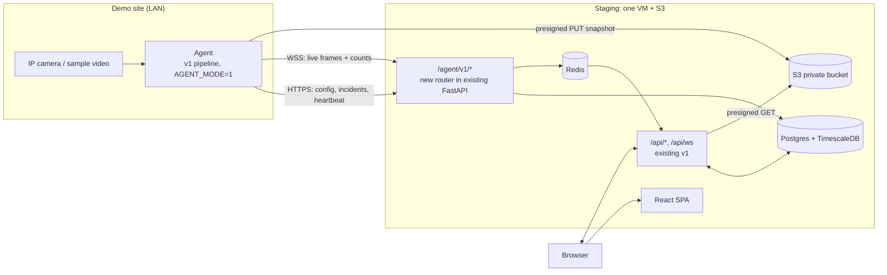

# Iso Safe PRD: v2 Phase 1a, First Cloud Demo (2 weeks)

**Oct 8, 2026 · @Fimber · Status: Draft for engineering kickoff**

This is the build spec for the first cloud demo of Iso Safe. It is a 2-week,
single-tenant **walking skeleton**: the edge runs detection, the cloud stores
and displays the results. It proves the v2 architecture end to end before the
larger Phase 1 build starts.

**Relationship to other documents**

| Document | Role |
|---|---|
| [PRD v2.0 Cloud Platform](PRD-v2-Cloud-Platform.md) | The full v2.0 target. This document carves a thin slice out of its Phase 1 and moves it to the front. Where the two conflict for the next 2 weeks, **this document wins**; after the demo, v2.0 is the spec again. |
| [PRD MVP v1.0 (Developer Edition)](PRD-MVP-v1-Developer-Edition.md) | What exists today. The demo reuses v1 code almost unchanged. |
| [Architecture](architecture.md), [Pipeline](pipeline.md) | How the code you are changing works today. |

---

## 0. Summary

At the end of week 2, on a public staging URL:

1. A small Linux box at a "site" runs the existing v1 pipeline in a new
   **agent mode**. It reads local cameras (or the sample video), runs YOLO,
   tracking and rules, and connects **outbound only** to the cloud over HTTPS/WSS.
2. The **cloud** runs the existing v1 API, WebSocket relay, Postgres, Redis and
   React dashboard, plus a small new **agent API**. It runs no inference.
3. A user anywhere opens `https://demo.<domain>`, logs in, adds a camera,
   draws a zone, applies a rule, sees the live annotated feed, and sees
   incidents with snapshots arrive in about 2 seconds.



**The one-sentence goal:** the v1 product, working the same way, except the
cameras are on a different network from the server and nothing at the site
accepts inbound connections.

---

## 1. Why this demo, and why it is small

The v2.0 plan reaches its first cloud demo after Phase 0 and all of Phase 1,
12–14 weeks in. This phase brings the first demo forward to week 2 by:

- **Reusing v1 code as-is.** No repo restructure, no new data model, no auth
  rebuild. The pipeline gets a second "sink" (the cloud) next to its existing
  database/Redis sink.
- **Running one tenant.** There are no orgs, sites or RLS. The demo stack holds
  exactly one customer's data, so isolation is not a concern **for the demo
  only**.
- **Using one VM.** One VM runs Docker Compose, instead of ECS, managed DB,
  CloudFront and WAF. One small Terraform module makes it re-creatable.

What the demo **proves**: outbound-only edge connectivity, cloud-side incident
storage and fan-out, private media via presigned URLs, live view across
networks, and deploy-from-CI. Those are the riskiest assumptions in v2.0.

What it **does not prove**: multi-tenancy, scale, offline durability, or
production readiness. Phase 1 still builds those (§9).

---

## 2. Goals and non-goals

### 2.1 Goals

| ID | Goal |
|---|---|
| DG1 | A camera on a private network produces incidents visible in a browser on a different network, with no inbound ports opened at the site. |
| DG2 | Live annotated video for a camera is viewable from the public URL. |
| DG3 | Cameras, zones and rules are configured in the cloud dashboard and take effect at the edge without touching the box. |
| DG4 | Snapshots are stored privately in S3 and never exposed through a public URL. |
| DG5 | Every merge to `main` deploys to staging automatically. |

### 2.2 Non-goals (explicitly deferred to v2.0 Phase 1 or later)

- Organizations, sites, multi-user tenancy, RLS, isolation test suite.
- New auth (sessions, invitations, email verification, MFA, lockout). v1 JWT
  login is used as-is.
- Agent pairing codes, rotating agent credentials, revocation UI. A single
  static agent token is used.
- Durable offline queue and 72 h backfill. Only short outages are covered
  (DEMO-FR-14).
- Track summaries and minute stats (ADR-04). Per-frame detections are **not**
  sent to the cloud. Analytics, reports, investigations and heatmaps will be
  empty or partial in the demo (§2.3).
- Email/webhook alerts from the cloud, AI assistant, ONVIF discovery, video
  uploads, LPR tuning.
- Repo restructure into `core`/`cloud`/`agent` (ADR-07), managed services,
  production environment, load test, cost model.
- Fixes from [known-issues.md](known-issues.md), except where they block the
  demo.

### 2.3 What the audience will and won't see

| Dashboard area | Demo state |
|---|---|
| Login, Cameras (add/edit, zones, rules, profiles) | Works |
| Live view (annotated frames, live counts) | Works |
| Incidents and Alerts (list, detail, snapshot, triage) | Works |
| Admin → System Health | Shows agent online/offline and camera health from heartbeats |
| Analytics, Reports, Investigations, heatmaps, AI assistant | **Hidden or labelled "coming soon"** in the demo build (feature flag), because they depend on per-frame detections that stay at the edge |
| Uploads | Hidden |

---

## 3. Architecture for the demo

### 3.1 Components

| Component | Runs where | Built from | Change |
|---|---|---|---|
| **Agent** | Demo box (Ubuntu + Docker), at the site | `backend/` image, `inference` entrypoint | New `AGENT_MODE=1` setting: config comes from the cloud, incidents/frames/health go to the cloud. No Postgres or Redis on the box. |
| **Cloud API** | Staging VM | `backend/` image, `backend` entrypoint | New router `backend/app/api/agent.py` mounted at `/agent/v1`; snapshot URLs become presigned S3 GETs. |
| **Postgres + TimescaleDB, Redis** | Staging VM (containers) | existing compose services | None. |
| **Frontend** | Staging VM (nginx) | `frontend/` | Feature flag to hide §2.3 areas; agent status on System Health. |
| **Reverse proxy + TLS** | Staging VM | existing `nginx` service | Let's Encrypt certificate; adds `/agent/v1` and its WebSocket route. |
| **Object storage** | S3, private bucket | new | Snapshots only. |

The cloud compose file is the v1 `docker-compose.yml` **without** the
`inference` service. That is a new compose profile or override file, not a
fork.

### 3.2 Where agent mode plugs into v1 code

| v1 behaviour | File | Agent mode behaviour |
|---|---|---|
| `reconcile()` reads `cameras` table every N s | `backend/app/pipeline/runner.py` | Reads the same shape of camera rows from `GET /agent/v1/config` (polled every 10 s, ETag-cached). Sources arrive already decrypted over TLS; the agent never holds `CAMERA_SECRET_KEY`. |
| `create_incident()` writes DB row, writes JPEG to `MEDIA_ROOT`, publishes to Redis | `backend/app/alerts/incidents.py` | Generates a UUID, `POST /agent/v1/incidents`, then PUTs the JPEG to the returned presigned URL. The cloud writes the row and publishes to Redis `ALERT_CHANNEL`, so the existing WebSocket fan-out works unchanged. |
| `CameraProcessor._publish` / `publish_preview` publish frames and counts to Redis | `backend/app/pipeline/camera_worker.py` | Sends the same JSON messages over the agent WebSocket. The cloud republishes them to Redis `FRAME_CHANNEL` unchanged. |
| `DetectionWriter` batches per-frame detections into Postgres | `backend/app/inference/writer.py` | No-op sink in agent mode. |
| Guards publish system alerts | `backend/app/pipeline/guards.py` | Sent as `POST /agent/v1/incidents` with the system type. |
| Background jobs (analytics, nightly, dispatcher) | `backend/app/pipeline/runner.py` | Disabled in agent mode. |

The rule is **one codebase, one switch**: `AGENT_MODE` picks the
sink implementation at startup. Rule engine, tracker, zones, profiles and
ingestion are untouched.

### 3.3 Demo decisions (valid for this phase only)

| ID | Decision | Why | Replaced in Phase 1 by |
|---|---|---|---|
| DD-01 | One VM (e.g. EC2 `t3.large`/`m6i.large`) runs the cloud compose stack. | Fastest path to a public URL; same stack devs run locally. | ECS Fargate + managed DB/Redis (ADR-06) |
| DD-02 | Agent authenticates with one static bearer token (`AGENT_TOKEN`), stored hashed in cloud config. | No pairing flow to build. | Pairing + rotating JWTs (§7.3 of v2.0) |
| DD-03 | Config is **polled** over HTTPS; live frames go over one WSS connection. | Polling avoids a control protocol; WSS is needed for frame volume. | `config.update` push over the control connection |
| DD-04 | Agent streams low-rate frames (`AGENT_LIVE_FPS`, default 2, ≤ 960 px) **continuously** for every camera. | On-demand `live.start/stop` needs viewer tracking; with 2–4 demo cameras the bandwidth is acceptable (~0.3–1 Mbit/s per camera). | On-demand live relay |
| DD-05 | Agent runs without a local database; incidents are created cloud-side with the agent's UUID. | Removes Postgres from the box. | Durable SQLite queue |
| DD-06 | Snapshot URLs in incident API responses are presigned S3 GETs (5 min). `/media/` is no longer served publicly on staging. | Fixes the public-media issue now at low cost; `` keeps working. | Same (ADR-05), plus `org_id` key prefix |
| DD-07 | The YOLOv8 (AGPL) model is used as-is. | The demo is not distributed to customers. | Owner decision D-05 before any customer install |

---

## 4. Functional requirements

Priorities: **P0** must work in the demo, **P1** should, **P2** if time allows.

### 4.1 Agent

| ID | Requirement | P |
|---|---|---|
| DEMO-FR-01 | `AGENT_MODE=1`, `CLOUD_URL`, `AGENT_TOKEN` env vars switch the pipeline to cloud sinks (§3.2). With `AGENT_MODE` unset, v1 behaviour is unchanged and all existing tests pass. | P0 |
| DEMO-FR-02 | Agent pulls camera config (id, name, type, source, zones, rules, refresh_secs, loop_file, enabled) from `GET /agent/v1/config` every 10 s and applies it through the existing reconcile logic. | P0 |
| DEMO-FR-03 | Agent sends each incident to `POST /agent/v1/incidents` with a client-generated UUID and uploads the annotated snapshot to the returned presigned URL. Resends are idempotent by UUID. | P0 |
| DEMO-FR-04 | Agent holds one WSS connection to `/agent/v1/stream` and sends live frame and count messages (same JSON as v1 `FRAME_CHANNEL`) at ≤ `AGENT_LIVE_FPS`. Reconnects with backoff (1 s → 30 s). | P0 |
| DEMO-FR-05 | Agent sends `POST /agent/v1/heartbeat` every 30 s with version, uptime, CPU/RAM/disk and per-camera health (online, fps, reconnects, dropped). | P0 |
| DEMO-FR-06 | One command starts the agent on a fresh Ubuntu box with Docker: `docker run -d --restart unless-stopped -e CLOUD_URL=… -e AGENT_TOKEN=… <image>` (documented in `deploy/agent/README.md`). | P0 |
| DEMO-FR-07 | Sample video cameras work on the agent (`/data/sample_videos` mounted). | P0 |
| DEMO-FR-14 | During a cloud outage of ≤ 5 minutes, incidents are kept in a bounded in-memory retry queue (≤ 500) and delivered after reconnect, without duplicates. | P1 |
| DEMO-FR-15 | Agent image built for CPU; CUDA image if a GPU box is available. | P1 / P2 |

### 4.2 Cloud

| ID | Requirement | P |
|---|---|---|
| DEMO-FR-20 | New router `/agent/v1` with `config`, `incidents`, `heartbeat`, `stream` endpoints. Every request requires `Authorization: Bearer <AGENT_TOKEN>`, compared in constant time. | P0 |
| DEMO-FR-21 | `POST /agent/v1/incidents` upserts by UUID, writes the incident row (`snapshot_path` = S3 key), returns a presigned PUT URL (5 min), and publishes the existing alert payload to Redis `ALERT_CHANNEL`. Requires an alembic migration adding a unique `uuid` column to `incidents`. | P0 |
| DEMO-FR-22 | `/agent/v1/stream` republishes received frame/count messages to Redis `FRAME_CHANNEL`, so `ws/manager.py` and the dashboard work unchanged. Messages over 1 MB are dropped. | P0 |
| DEMO-FR-23 | Incident list/detail and the alert WS payload return `snapshot_url` as a 5-minute presigned S3 GET. nginx no longer serves `/media/` on staging. | P0 |
| DEMO-FR-24 | Heartbeats are stored in Redis (`agent:last_seen`, health JSON). The agent is **online** if last seen ≤ 90 s ago. Camera health shown on System Health comes from heartbeats. | P0 |
| DEMO-FR-25 | Camera create/edit in the dashboard bumps a config version; the agent picks up changes within 15 s. | P0 |
| DEMO-FR-26 | When the agent goes offline, a system incident `agent_offline` is created once and resolved on reconnect. | P1 |
| DEMO-FR-27 | `/agent/v1/*` is rate-limited (existing limiter) and request bodies are capped at 1 MB. | P1 |

### 4.3 Frontend

| ID | Requirement | P |
|---|---|---|
| DEMO-FR-40 | Build-time flag `VITE_DEMO_MODE=1` hides Analytics, Reports, Investigations, AI and Uploads from navigation (or shows a "coming soon" card). | P0 |
| DEMO-FR-41 | System Health shows agent status (online/offline, last seen, version) and per-camera health. | P0 |
| DEMO-FR-42 | API base URL and WS URL work behind the public domain over HTTPS/WSS (no hard-coded `localhost`). | P0 |

### 4.4 Infrastructure and delivery

| ID | Requirement | P |
|---|---|---|
| DEMO-FR-60 | `infra/demo/` Terraform: VPC (default is fine), one VM, security group (443/80 in; SSH from the owner's/dev's IPs only), Elastic IP, S3 bucket (private, SSE, block public access), IAM role for the VM with access to that bucket only, DNS record. | P0 |
| DEMO-FR-61 | GitHub Actions: on PR, run lint and `pytest`; on merge to `main`, build images, push to a registry (GHCR or ECR), SSH-deploy to the VM (`docker compose pull && up -d`), run `alembic upgrade head`, run `scripts/smoke_api.py` against staging. | P0 |
| DEMO-FR-62 | TLS via Let's Encrypt on the staging domain; HTTP redirects to HTTPS. | P0 |
| DEMO-FR-63 | Secrets (`JWT_SECRET`, `CAMERA_SECRET_KEY`, `AGENT_TOKEN`, DB password) in GitHub Actions secrets and a root-only `.env` on the VM; nothing secret in the repo. | P0 |
| DEMO-FR-64 | Nightly `pg_dump` (existing `backup` service) copied to the S3 bucket. | P2 |
| DEMO-FR-65 | AWS budget alarm on the account (e.g. $100/month). | P1 |

---

## 5. Interfaces

All endpoints are under `https://demo.<domain>/agent/v1`, JSON over TLS, and
require `Authorization: Bearer <AGENT_TOKEN>`.

```
GET  /agent/v1/config
     If-None-Match: "<config_version>"
→ 304, or 200 {"config_version": "17", "cameras": [{id, name, type, source,
     zones, rules, refresh_secs, loop_file, enabled}, ...]}

POST /agent/v1/incidents
     {"uuid": "...", "camera_id": "...", "rule_id": "...", "type": "loitering",
      "severity": "high", "ts": 1760000000.123, "details": {...}, "has_snapshot": true}
→ 200 {"incident_id": 812, "snapshot_put_url": "https://s3...", "duplicate": false}

POST /agent/v1/heartbeat
     {"agent_version": "1.x-agent", "uptime_s": 3600, "cpu": 41.2, "mem": 63.0,
      "disk_free_gb": 120, "cameras": [{camera_id, online, fps, reconnects, dropped}]}
→ 204

WSS  /agent/v1/stream   (token in Authorization header, or ?token= if the client cannot set headers)
     agent → cloud: text messages identical to v1 FRAME_CHANNEL payloads
     both: ping/pong every 20 s
```

S3 key layout: `snapshots/{yyyy}/{mm}/{dd}/{incident_uuid}.jpg`, which is v2.0
§7.4 without the `orgs/{org_id}/` prefix. Phase 1 migrates it by adding the prefix.

---

## 6. Non-functional targets (demo)

| ID | Area | Target |
|---|---|---|
| DEMO-NFR-01 | Alert latency | Rule fires on agent → incident visible in browser: p95 ≤ 2 s over a normal broadband link. |
| DEMO-NFR-02 | Live view | First frame ≤ 3 s after opening the camera; ≥ 1 fps sustained. |
| DEMO-NFR-03 | Scale | 1 agent, up to 4 cameras, up to 5 concurrent browser users. Nothing more is claimed. |
| DEMO-NFR-04 | Stability | Agent and cloud run 24 h unattended before the demo without restarts or memory growth > 20 %. |
| DEMO-NFR-05 | Security floor | HTTPS only; no public `/media/`; agent token required; SSH restricted; S3 bucket not public; default admin password changed; no secrets in the repo or logs. |
| DEMO-NFR-06 | Bandwidth | Agent upstream ≤ 1 Mbit/s per camera at default `AGENT_LIVE_FPS`. |
| DEMO-NFR-07 | Regression | With `AGENT_MODE` unset, `pytest` and `scripts/smoke_api.py` pass on the v1 compose stack. |

---

## 7. Delivery plan (10 working days)

Indicative dates assume a start on **Mon Oct 12, 2026** and a demo on
**Fri Oct 23, 2026**. Each day ends with something running.

| Day | Date | Work | Done when |
|---|---|---|---|
| 1 | Mon Oct 12 | Accounts and access in hand (§10). CI on PRs (lint + pytest). Cloud compose profile without `inference`. | CI green on `main`; cloud stack runs locally without inference |
| 2 | Tue Oct 13 | `AGENT_MODE` switch and sink interfaces; `GET /agent/v1/config` + agent reconcile from cloud. | Locally, an agent container with no DB starts a sample-video camera configured in the cloud UI |
| 3 | Wed Oct 14 | `POST /agent/v1/incidents` + `uuid` migration + Redis publish; agent incident sink; MinIO locally for presigned PUT. | A loitering incident from the agent appears in the local dashboard with snapshot |
| 4 | Thu Oct 15 | `/agent/v1/stream` WSS + agent frame sink; heartbeat endpoint + agent heartbeats. | Live view and live counts work through the cloud; agent shows online |
| 5 | Fri Oct 16 | Presigned GET snapshot URLs; tests for agent API (auth, idempotency, oversize); **mid-point demo locally** to owner. | `pytest` green, both modes |
| 6 | Mon Oct 19 | `infra/demo` Terraform: VM, S3, IAM, DNS, Elastic IP; TLS; first manual deploy. | `https://demo.<domain>` serves the login page |
| 7 | Tue Oct 20 | Deploy workflow from `main`; staging smoke test; secrets wired. | Merge to `main` deploys to staging unattended |
| 8 | Wed Oct 21 | Agent on the real box with real cameras against staging; latency measurement; frontend demo flag + System Health agent status. | Real camera incident visible on the public URL |
| 9 | Thu Oct 22 | P1 items (retry queue, `agent_offline`, budget alarm); bug fixing; start 24 h soak. | Soak running; no P0 bugs open |
| 10 | Fri Oct 23 | Soak review, demo script dry run, write [§8 demo script](#8-acceptance-demo-script) results, **demo**. | Owner signs off §8 |

**Scope rule:** if a day slips, cut P1/P2 items first and never add scope. If
day 6 starts without the cloud account or domain, the demo date moves by the
same number of days.

---

## 8. Acceptance (demo script)

Run on staging, from a laptop on a **different network** from the agent (e.g.
a phone hotspot).

1. Open `https://demo.<domain>`. The certificate is valid. Log in as admin.
2. System Health shows the agent **online**, with version and last-seen ≤ 30 s.
3. Add a camera by RTSP URL (a real camera at the site) and the `vtest.avi`
   sample-video camera. Both show **online** within 15 s and live annotated
   frames within 3 s of opening.
4. Apply the supermarket profile and draw a zone on the real camera; add a
   loitering rule. Walk into the zone. The incident appears in the browser in
   ≤ 2 s with its snapshot.
5. Open the incident, acknowledge and resolve it. The change persists after reload.
6. Copy the snapshot URL, wait 6 minutes, open it in a private window: access is
   **denied**. `https://demo.<domain>/media/...` returns 404.
7. Call `GET /agent/v1/config` without a token: **401**.
8. Change a rule in the dashboard; the agent applies it within 15 s without
   being touched.
9. Stop the agent container: within 2 minutes System Health shows it
   **offline** (and an `agent_offline` incident, if P1 shipped). Start it again:
   it returns to online and live view resumes on its own.
10. On the site router, confirm **no inbound port forwards** exist.
11. Show the last merge to `main` deploying to staging in GitHub Actions.

**Done** = steps 1–11 pass, the 24 h soak meets DEMO-NFR-04, and the v1
regression (DEMO-NFR-07) is green.

---

## 9. What carries forward and what is thrown away

| Built in Phase 1a | Fate in v2.0 Phase 1 |
|---|---|
| `AGENT_MODE` sinks and the agent/cloud split in the pipeline | **Kept**; moved into the `agent` app during the repo restructure |
| `/agent/v1` router and incident UUID idempotency | **Kept and extended**: pairing, JWTs, `org_id`/`site_id`, control WS, tracks, minute stats |
| Presigned S3 snapshot handling | **Kept**; adds `orgs/{org_id}/` prefix and authorization check |
| CI workflow | **Kept and extended** (isolation suite, scans, migrations test) |
| Static agent token | **Replaced** by pairing + rotating credentials |
| Config polling, continuous low-FPS frames | **Replaced** by `config.update` push and on-demand live relay |
| In-memory retry queue | **Replaced** by durable SQLite queue |
| Single-VM Terraform + SSH deploy | **Replaced** by ECS/managed services; the VM is destroyed |
| `VITE_DEMO_MODE` flag | **Removed** once analytics work on track summaries |

Roughly 60–70 % of the code written here survives into Phase 1. The rest is
deliberate scaffolding that lets the demo happen in 2 weeks.

**Effect on the overall v2.0 timeline:** roughly +1 week net. Phase 0's repo
restructure and known-issue fixes move after the demo, and Phase 1 shrinks by
the work already done. The v2.0 delivery plan (§10) is re-estimated after the
demo, using what this phase reveals.

---

## 10. What the owner provides (needed by day 1 unless noted)

| Item | Needed by |
|---|---|
| AWS account with billing; developer IAM role with admin on a demo sub-account or tagged resources | Day 1 (hard blocker by day 6) |
| A domain or subdomain and DNS access (e.g. `demo.isosafe.<tld>`) | Day 1 (hard blocker by day 6) |
| GitHub repo admin (Actions secrets, environments) | Day 1 |
| Demo site: one Ubuntu mini PC with Docker, on a normal internet connection, and 1–2 real IP cameras with RTSP URLs | Day 7 |
| 30 minutes on day 5 for the mid-point demo; 1 hour on day 10 for the demo | Day 5, day 10 |
| Answers to §11 | Day 2 |

---

## 11. Decisions required from the owner

The default is what gets built if there is no answer by day 2.

| ID | Decision | Default | Alternatives |
|---|---|---|---|
| DQ-01 | Cloud provider and region for staging | AWS, region closest to the demo audience | A VPS provider (Hetzner, DigitalOcean): cheaper and simpler, but Phase 1 then has to migrate |
| DQ-02 | Demo audience | Internal / owner only | Investors or a friendly pilot customer: needs a dry run and stricter NFR-04 soak |
| DQ-03 | Hide or show v1 analytics pages | Hide (DEMO-FR-40) | Show with empty states |
| DQ-04 | Does the D-05 detector licensing decision need to be made now? | No, the demo is not distributed | Yes, if a pilot customer will keep the box after the demo |

---

## 12. Risks

| Risk | Impact | Mitigation |
|---|---|---|
| Accounts, domain or demo box arrive late | Demo date slips day for day | Days 1–5 run fully locally (MinIO stands in for S3); cloud work starts on day 6 |
| Site uplink too slow for continuous frames | Choppy live view | Lower `AGENT_LIVE_FPS` and JPEG quality; demo on the sample video if needed |
| Corporate firewall at the demo site blocks WSS | No live view | Test from the site on day 8; WSS on 443 through the same host as the API |
| Hidden coupling between pipeline and DB/Redis beyond §3.2 | Day 2–4 overrun | Trace done in advance (§3.2); anything else found is stubbed in agent mode and logged |
| Demo mistaken for a product | Pressure to give it to customers | It is single-tenant with a static token: **no customer data** on this stack, stated in the demo |
| Scope creep ("can it also send email / show analytics?") | Demo misses date | Only §4 P0/P1; everything else goes to Phase 1 |

---

**Document control:** v2 Phase 1a, First Cloud Demo, draft 1. Derived from
[PRD v2.0 Cloud Platform](PRD-v2-Cloud-Platform.md) §10. Supersedes v2.0
Phase 0 ordering for the 2 weeks it covers.
