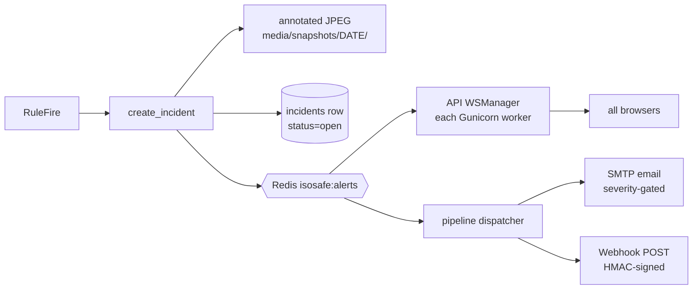
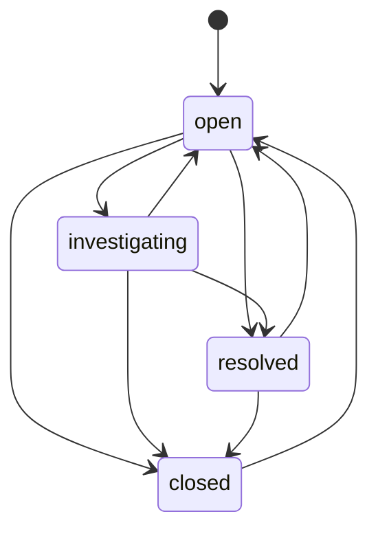

# Alerts and Incidents

An **incident** is a persisted record of a rule firing. An **alert** is the
real-time notification of that incident, fanned out over WebSocket, email, and
webhook.



## Creating an incident

[backend/app/alerts/incidents.py](../backend/app/alerts/incidents.py) —
`create_incident(camera_id, fire, image, ts)`:

1. **Snapshot.** Unless the disk guard has paused snapshots, the full-resolution
   frame is copied, the triggering track's box is drawn in a severity colour
   (info = blue, warning = orange, critical = red) with the incident type as a
   label, and the image is written as JPEG (quality 85) to:

   ```
   MEDIA_ROOT/snapshots/<YYYY-MM-DD UTC>/<camera_id>_<epoch ms>_<incident_type>.jpg
   ```

   `queue_threshold` and `crowd_density` have no triggering track, so their
   snapshot is the plain frame.
2. **Row.** Insert into `incidents` with `status='open'`, the frame timestamp,
   type, severity, description, and the snapshot path relative to `MEDIA_ROOT`.
3. **Publish.** Publish to `isosafe:alerts`:

   ```json
   {
     "type": "incident",
     "id": 1842,
     "camera_id": "cam-3f9a12c0",
     "incident_type": "loitering",
     "severity": "warning",
     "description": "Person loitering for 34s in zone 'entrance'",
     "snapshot_url": "/media/snapshots/2026-10-07/cam-3f9a12c0_1759832012345_loitering.jpg",
     "ts": "2026-10-07T10:13:32.345000+00:00"
   }
   ```
4. **Metrics.** Increment `isosafe_incidents_total{incident_type,severity}` and
   observe `isosafe_alert_dispatch_latency_seconds` = time from frame capture to
   publish.

Incident descriptions are generated by the rule handlers, e.g.
`"Person loitering for 34s in zone 'entrance'"`,
`"Car stationary for 12s"`,
`"Person entered restricted zone 'restricted'"`,
`"Queue length 7 exceeds threshold 5 in zone 'queue'"`,
`"Unattended backpack stationary for 61s with no person nearby"`.

## System self-alerts

The resource guards publish alerts with `camera_id: "system"`,
`incident_type: "system_health"`, `severity: "critical"` (memory recycle, low
disk). They travel the same channel, so they reach the dashboard, email, and
webhooks, but they have no `id` and **no database row**.

## Fan-out channels

### WebSocket (dashboard)

Every API worker runs one Redis subscription (`WSManager._redis_pump`) and
forwards every alert to **every** connected client regardless of camera
subscriptions. The frontend shows them in the header bell, the Dashboard's
Live Alerts panel, the AI Alerts page, and as a pulsing coloured border on the
camera tile for 15 seconds. See [API reference › WebSocket](api-reference.md#websocket-apiws).

Clients that connect later don't receive past alerts over the socket; the UI
loads history from `GET /api/incidents`.

### Email

[backend/app/alerts/dispatcher.py](../backend/app/alerts/dispatcher.py), running
in the pipeline process.

Sent when `SMTP_HOST` and `ALERT_EMAIL_TO` are set and the alert severity ≥
`ALERT_EMAIL_MIN_SEVERITY` (`info` < `warning` < `critical`).

```
Subject: [Iso Safe CRITICAL] zone_intrusion on cam-3f9a12c0

Person entered restricted zone 'restricted'

Time: 2026-10-07T10:13:32.345000+00:00
Camera: cam-3f9a12c0
```

The connection always issues `STARTTLS` (port 587 style); implicit-TLS port 465
servers and plaintext-only relays are not supported without a code change. SMTP
runs in a thread executor with a 15 s timeout. Failures are logged; there is no
retry or queue. The email contains no snapshot attachment or link.

### Webhook

Sent for **every** alert (no severity filter) when `WEBHOOK_URL` is set. The body
is the alert JSON above, `Content-Type: application/json`, 10 s timeout, no
retry. Non-2xx responses are logged as warnings.

With `WEBHOOK_SECRET` set, the request carries:

```
X-IsoSafe-Signature: sha256=<hex HMAC-SHA256 of the raw request body, keyed with WEBHOOK_SECRET>
```

Verify it on the receiver against the **raw bytes**, before parsing JSON:

```python
import hashlib
import hmac

def verify(raw_body: bytes, header: str, secret: str) -> bool:
    expected = "sha256=" + hmac.new(secret.encode(), raw_body, hashlib.sha256).hexdigest()
    return hmac.compare_digest(expected, header or "")
```

`snapshot_url` is a path relative to the Iso Safe host
(`https://<host>/media/...`).

The dispatcher reconnects to Redis automatically after errors (3 s pause). Alerts
published while it is disconnected — or while the inference container is down —
are not delivered by email/webhook (Redis pub/sub has no persistence). The
incident rows themselves are always in the database.

## Incident lifecycle

Statuses: `open` → `investigating` → `resolved` → `closed`. Allowed transitions
([backend/app/api/incidents.py](../backend/app/api/incidents.py)):



- Setting the same status again is a no-op, not an error.
- Any other transition returns **409** `Cannot transition X -> Y`.
- Moving to `resolved` stamps `resolved_at`. Reopening does not clear it.

Operators and admins can change `status`, `assigned_to` (free text — the UI
offers the user list's emails to admins), and `resolution_notes` through
`PATCH /api/incidents/{id}`. Every change is written to `audit_log` as
`incident.update`.

Incidents are never deleted by the application. Deleting a camera leaves its
incidents (and detections) in place.

## Operator workflow

1. An alert arrives — the bell gets a red dot, the camera tile pulses, the alert
   appears on the Dashboard and AI Alerts pages.
2. Click it to open the incident: severity, description, camera, time, and the
   annotated snapshot.
3. Set status to **Investigating**, assign it, and add notes.
4. When handled, set **Resolved** (records `resolved_at`), then **Closed** once
   reviewed. Reopen if needed.
5. Use **Reports → Incident Report / Weekly Security** for the period summary.
