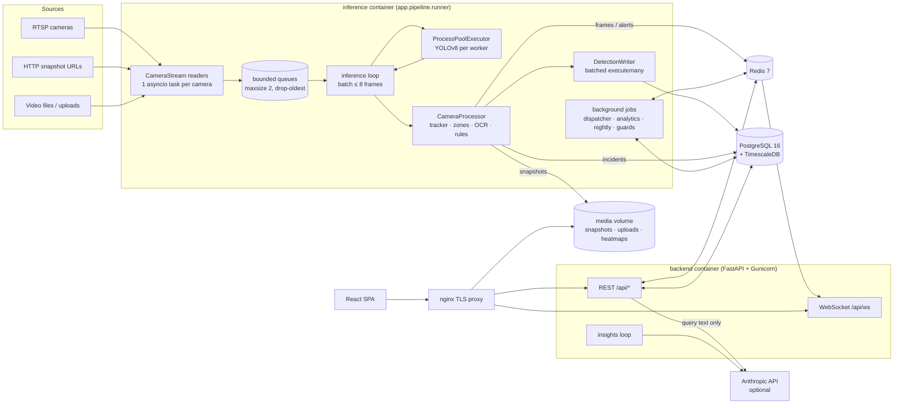

# Architecture

## System overview



## Containers

All services are defined in [docker-compose.yml](../docker-compose.yml) on a
single bridge network `isosafe`.

| Service | Image / build | Process | Responsibility |
|---|---|---|---|
| `postgres` | `timescale/timescaledb:latest-pg16` | postgres | System of record: cameras, detections (hypertable), incidents, analytics, users, audit |
| `redis` | `redis:7-alpine` (512 MB, `allkeys-lru`) | redis-server | Pub/sub bus, live counts, camera health, heatmap grids, insights cache, rate-limit counters |
| `backend` | `./backend` | `alembic upgrade head && gunicorn app.main:app -k uvicorn.workers.UvicornWorker -w $API_WORKERS` | REST API, WebSocket relay, admin bootstrap, hourly AI insights |
| `inference` | `./backend` (same image) | `python -m app.pipeline.runner` | Stream ingestion, YOLO, tracking, OCR, rules, incidents, analytics jobs, alert email/webhook dispatch, resource guards |
| `frontend` | `./frontend` (Node 22 build → nginx) | nginx | Serves the compiled Vite SPA |
| `nginx` | `nginx:1.27-alpine` | nginx | TLS termination; routes `/api/ws`, `/api/`, `/media/`, `/` |
| `prometheus` | `prom/prometheus` | prometheus | Scrapes `backend:8000/api/metrics` every 15 s |
| `backup` | `timescale/timescaledb:latest-pg16` | [deploy/backup.sh](../deploy/backup.sh) | Nightly `pg_dump -Fc` at 02:30 UTC, 14-day rotation |

Volumes: `pgdata` (database), `media` (shared by backend, inference, nginx),
`models` (YOLO weights / Ultralytics config cache), `promdata`. The host folder
`./sample_videos` is mounted read-only into the inference container at
`/data/sample_videos`, and `./deploy/backups` is mounted into postgres and backup.

The `backend` and `inference` containers run the **same Python codebase**; they
differ only in entrypoint and the `ROLE` env var (informational).

## Process split: why two Python services

Video work is CPU/GPU heavy and long-running; API work is latency-sensitive and
must scale horizontally across Gunicorn workers. Splitting them means:

- A crashing or memory-recycling pipeline never takes the dashboard down.
- API workers stay stateless; they share live state through Redis.
- The pipeline is a single process (plus its YOLO worker pool), so per-camera
  state — trackers, rule cooldowns, heatmap counters — lives in memory without
  any distributed coordination.

The consequence is that **one inference container owns all cameras on a node**.
There is no sharding of cameras across multiple inference containers; running
two would process every camera twice.

## Data flow, end to end

1. **Configuration.** An admin creates a camera through `POST /api/cameras`. The
   row (with Fernet-encrypted source, zones JSONB, rules JSONB) is written to
   `cameras`.
2. **Reconcile.** Within 15 s, `Pipeline.reconcile()` sees the new enabled row,
   decrypts the source, and starts a `CameraStream` task and a `CameraProcessor`.
   Edits to zones/rules on existing cameras are pushed into the running
   processor on the same cycle; disabled or deleted cameras are stopped.
3. **Ingest.** The stream reads frames (OpenCV for RTSP/file, httpx for snapshot
   URLs) and enqueues every `PROCESS_EVERY_N_FRAMES`-th frame into a queue of size
   2. If the queue is full the oldest frame is discarded — detection always runs
   on the freshest image.
4. **Batch.** The inference loop takes at most one frame from each camera queue,
   up to `INFERENCE_BATCH_SIZE`, publishes an un-annotated preview for each, JPEG
   encodes them, and sends the batch to the process pool.
5. **Detect.** A worker process decodes, resizes to `INFERENCE_MAX_DIM`, runs one
   batched `model.predict`, keeps 7 COCO classes, applies per-class confidence
   thresholds, and returns normalized `[x1, y1, x2, y2]` boxes.
6. **Process.** For each frame, the camera's `CameraProcessor`:
   - updates the centroid tracker (stable `track_id`s, session counts),
   - tags each detection with the polygon zones containing its centroid,
   - runs plate OCR on vehicles every `OCR_EVERY_N_FRAMES` processed frames,
   - buffers a detection row in `DetectionWriter`,
   - evaluates the camera's rules and creates incidents for any that fire,
   - increments the Redis person heatmap grid,
   - writes live counts to Redis (≤ 1/s) and publishes an annotated JPEG to the
     frame channel (throttled to `DASHBOARD_MAX_FPS`).
7. **Persist.** `DetectionWriter` flushes buffered rows with asyncpg
   `executemany` every 2 s or 200 rows.
8. **Alert.** `create_incident()` saves an annotated snapshot, inserts the
   incident row, and publishes it to `isosafe:alerts`. Two subscribers react:
   - the pipeline's alert dispatcher sends email (severity-gated) and an
     HMAC-signed webhook;
   - every API worker's `WSManager` forwards it to all connected browsers.
9. **Aggregate.** Every 5 minutes the pipeline upserts `analytics_hourly` for the
   current hour; on each new hour it snapshots heatmaps to disk; nightly at 02:00
   UTC it rolls up `analytics_daily`, prunes old snapshots, and times out stuck
   upload jobs.
10. **Present.** The SPA polls REST endpoints for KPIs, analytics, and lists, and
    holds a single WebSocket for live frames, counts, and incidents.

## Redis keys and channels

Defined in [backend/app/redis_client.py](../backend/app/redis_client.py).

| Key / channel | Type | Writer | Reader | Contents |
|---|---|---|---|---|
| `isosafe:frames` | pub/sub | pipeline (`CameraProcessor`) | API `WSManager` | `{"type":"frame","camera_id","image"(base64 JPEG),"counts","in_frame","ts"}` |
| `isosafe:alerts` | pub/sub | `create_incident`, resource guards | API `WSManager`, pipeline dispatcher | `{"type":"incident","id","camera_id","incident_type","severity","description","snapshot_url","ts"}` |
| `isosafe:counts` | hash | pipeline, ≤ 1 write/s/camera | `GET /api/counts` | field = camera id, value = JSON `{in_frame, session, ts}` |
| `isosafe:camera_health:<id>` | string, TTL 120 s | `CameraHealth` | `GET /api/cameras` | `{last_frame_ts, reconnect_count, fps, frames_dropped}` |
| `isosafe:heatmap:<id>` | hash, TTL 2 h | pipeline | hourly heatmap snapshot job | field `gx:gy` (32×32 grid) → person-centroid hit count |
| `isosafe:insights` | string, TTL 24 h | `generate_insights` | `GET /api/insights` | `{generated_at, insights:[...]}` |
| `isosafe:rl:<key>:<ip>` | counter, TTL = window | `rate_limit` dependency | same | fixed-window request count |

## Concurrency model

- **Pipeline process:** one asyncio event loop. Blocking calls (OpenCV
  `VideoCapture.read`, EasyOCR, SMTP) run in the default thread executor. YOLO
  runs in a `ProcessPoolExecutor` with `INFERENCE_WORKERS` processes, each loading
  the model once in its initializer and warming it up. If a worker dies
  (`BrokenProcessPool`) the pool is rebuilt and the batch retried once; a second
  failure returns empty detections for that batch rather than stalling.
- **API process:** Gunicorn with `API_WORKERS` Uvicorn workers. Each worker has its
  own SQLAlchemy async engine (pool 10 + 20 overflow), its own asyncpg pool (2–10),
  and its own single Redis subscription that fans out to its local WebSocket
  clients.
- **Back-pressure** is applied at two places, both drop-oldest: the per-camera
  frame queue (size 2) and the per-WebSocket-client send queue (size 30). Neither
  can grow without bound under load.

## Key design decisions

| Decision | Rationale |
|---|---|
| Normalized coordinates (0..1) everywhere | Zones, boxes, tracker distances and heatmaps are resolution-independent; a camera can change resolution without redrawing zones. |
| Rules and zones as JSONB on the camera row | Adding a rule instance needs no code or migration; the pipeline hot-reloads them within 15 s. Adding a rule *type* needs code in `rules/engine.py`. |
| Drop-oldest queues | Alert latency matters more than completeness; a backlog of stale frames would delay every alert. |
| Batch across cameras | One YOLO call for N frames is the largest throughput gain on GPU and still helps on CPU. |
| Batched detection writes via raw asyncpg | Row-by-row inserts in the frame loop would bottleneck on DB round-trips. |
| Redis pub/sub between pipeline and API | Lets multiple Gunicorn workers share live data without sticky sessions. |
| Subscribe-to-watch frames | Browsers get full frames only for cameras they display; everything else becomes small count messages, so bandwidth scales with what operators look at. |
| SQLAlchemy Core, not ORM | Explicit SQL, no session state, works for both API and the pipeline. |
| Only query text leaves the network | The AI assistant sends the schema DDL and the operator's question to Anthropic; never frames, video, or result rows. AI insights send aggregated analytics and open-incident summaries (see [Analytics, reports and AI](analytics-and-ai.md#data-sent-to-anthropic)). |

## Source layout

```
backend/
  app/
    main.py              FastAPI app factory, admin bootstrap, insights loop
    config.py            pydantic-settings; every tunable
    security.py          bcrypt, JWT, Fernet source encryption, redaction
    logging_config.py    JSON logs with request_id / camera_id
    metrics.py           Prometheus metric objects
    redis_client.py      shared Redis client + key names
    db/                  engine (SQLAlchemy + asyncpg pool), table definitions
    api/                 routers: auth, users, cameras, detections, incidents,
                         stats, uploads, search, reports, health; deps (RBAC,
                         rate limit, audit)
    ws/                  WebSocket endpoint + Redis-backed manager
    ingestion/           CameraStream readers, camera health, ONVIF discovery
    inference/           YOLO worker, centroid tracker, OCR, batched writer
    pipeline/            runner (orchestrator), per-camera processor, guards
    rules/               rule engine, zone geometry
    alerts/              incident creation, email/webhook dispatcher
    analytics/           hourly/daily aggregation, heatmaps, maintenance
    profiles/            14 vertical profiles (rule templates)
    search/              NL→SQL, SQL validator, AI insights
  alembic/               migrations (0001_initial_schema)
  scripts/               benchmarks, smoke test, e2e, load test, admin reset
  tests/                 pytest unit tests
frontend/
  src/
    App.jsx, main.jsx    router + auth gate
    lib/                 api client (JWT refresh), formatting helpers
    hooks/               useAuth, usePolling, useWebSocket
    components/          Layout, CameraTile, ZoneEditor, KpiCard
    views/               one file per screen
deploy/                  nginx.conf, prometheus.yml, backup.sh, RESTORE.md
```
