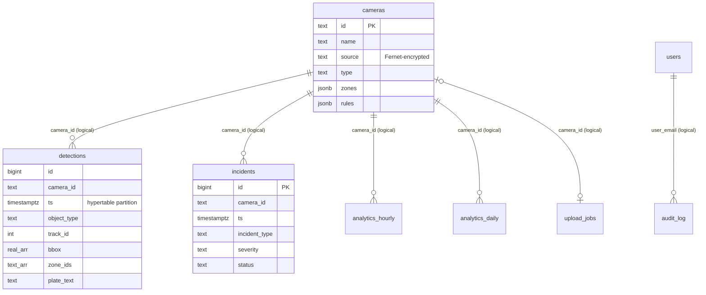

# Database

PostgreSQL 16 with the TimescaleDB extension (the stock `timescale/timescaledb`
image) and `pg_trgm`. The schema is defined twice and must be kept in sync:

- [backend/app/db/tables.py](../backend/app/db/tables.py) — SQLAlchemy Core
  `Table` objects used by the application.
- [backend/alembic/versions/](../backend/alembic/versions/) — migrations, the
  only way schema changes reach a database.

Access paths:

- **SQLAlchemy async engine** (`get_engine()`, pool 10 + 20 overflow,
  `pool_pre_ping`) for all API queries and pipeline incident/analytics writes.
- **Raw asyncpg pool** (`get_asyncpg_pool()`, 2–10 connections) for the
  high-volume detection writer and for executing AI-generated SQL.

Both use the same `DATABASE_URL` credentials.

## Entity overview



There are **no foreign keys**. Relationships are by convention, so deleting a
camera leaves its detections, incidents, and analytics rows intact (useful for
history, but they become orphaned).

## Tables

### `cameras`

| Column | Type | Default | Notes |
|---|---|---|---|
| `id` | text PK | | `cam-<8 hex>` for API-created cameras, `upload-<8 hex>` for uploads |
| `name` | text, not null | | |
| `source` | text, not null | | RTSP URL, snapshot URL, or file path. Stored as `enc:<fernet token>` when `FERNET_KEY` is set |
| `type` | text, not null | | `rtsp` \| `snapshot_url` \| `file` (validated in the API, not by a DB constraint) |
| `vertical_profile` | text | | profile id, informational after creation |
| `zones` | jsonb, not null | `[]` | see [Rules, zones and profiles](rules-and-zones.md#zones) |
| `rules` | jsonb, not null | `[]` | see [Rules, zones and profiles](rules-and-zones.md#rules) |
| `refresh_secs` | real | `2` | snapshot polling interval |
| `loop_file` | boolean | `true` | loop `file` sources |
| `enabled` | boolean | `true` | pipeline only runs enabled cameras |
| `created_at` | timestamptz | `now()` | |

### `detections` (hypertable)

One row per detected object per processed frame.

| Column | Type | Notes |
|---|---|---|
| `id` | bigint identity, not null | **not** a primary key (TimescaleDB requires the partition column in unique constraints) |
| `camera_id` | text, not null | |
| `ts` | timestamptz, not null | frame capture time; partition column |
| `object_type` | text, not null | `person`, `car`, `motorcycle`, `bus`, `truck`, `backpack`, `suitcase` |
| `confidence` | real, not null | YOLO confidence |
| `track_id` | integer | per camera, resets on pipeline restart |
| `bbox` | real[] | `[x1, y1, x2, y2]`, normalized 0..1 |
| `zone_ids` | text[] | polygon zones containing the centroid; `NULL` when none |
| `plate_text` | text | OCR result (uppercase alphanumeric, 4–10 chars), only on frames where a new read was accepted |
| `plate_confidence` | real | |

### `incidents`

| Column | Type | Default | Notes |
|---|---|---|---|
| `id` | bigint identity PK | | |
| `camera_id` | text, not null | | `system` is never stored (self-alerts aren't persisted) |
| `ts` | timestamptz, not null | | frame time of the fire |
| `incident_type` | text, not null | | the rule type |
| `severity` | text, not null | | CHECK `info` / `warning` / `critical` |
| `description` | text | | generated by the rule |
| `snapshot_path` | text | | relative to `MEDIA_ROOT`; `NULL` if snapshots were paused or the write failed |
| `clip_path` | text | | reserved; never written |
| `status` | text | `open` | CHECK `open` / `investigating` / `resolved` / `closed` |
| `assigned_to` | text | | free text (email in the UI) |
| `resolved_at` | timestamptz | | set when status becomes `resolved` |
| `resolution_notes` | text | | |

### `analytics_hourly` (hypertable)

PK `(camera_id, bucket)`. Columns: `footfall` int, `vehicles` jsonb,
`avg_queue` real, `max_queue` int, `avg_occupancy` real, `incident_count` int.
Definitions in [Analytics](analytics-and-ai.md#hourly-metrics).

### `analytics_daily`

PK `(camera_id, day)`. Same metric columns plus `peak_hour` int (0–23 UTC).

### `upload_jobs`

| Column | Type | Notes |
|---|---|---|
| `id` | uuid PK | job id, also the stored filename stem |
| `filename` | text | original upload name |
| `camera_id` | text | the generated `upload-…` camera |
| `status` | text, default `pending` | API inserts `processing`; nightly cleanup sets `error` after 6 h |
| `error` | text | |
| `created_at` / `completed_at` | timestamptz | `completed_at` is never set today |

### `users`

| Column | Type | Notes |
|---|---|---|
| `id` | uuid PK | |
| `email` | text, unique, not null | stored lowercase |
| `password_hash` | text | bcrypt |
| `role` | text | CHECK `admin` / `operator` / `viewer` |
| `created_at` | timestamptz | |

### `audit_log`

| Column | Type | Notes |
|---|---|---|
| `id` | bigint identity PK | |
| `ts` | timestamptz, default `now()` | |
| `user_email` | text | actor |
| `action` | text | `camera.create`, `camera.update`, `camera.delete`, `user.create`, `user.update`, `user.delete`, `incident.update`, `upload.create` |
| `target` | text | camera id, user id/email, incident id, or job id |
| `payload` | jsonb | changed fields; camera `source` and passwords are masked as `***` |

There is no API to read the audit log; query it directly:

```sql
SELECT ts, user_email, action, target, payload FROM audit_log ORDER BY ts DESC LIMIT 50;
```

## Indexes

| Index | Table | Definition | Serves |
|---|---|---|---|
| `ix_detections_camera_ts` | detections | `(camera_id, ts DESC)` | per-camera time-range queries, cursor pagination |
| `ix_detections_plate_trgm` | detections | GIN `plate_text gin_trgm_ops` WHERE `plate_text IS NOT NULL` | `ILIKE '%ABC%'` plate search |
| `ix_incidents_camera_ts` | incidents | `(camera_id, ts DESC)` | incident lists per camera |
| `ix_incidents_status_severity` | incidents | `(status, severity)` | open-incident counts, filters |

TimescaleDB also creates its own `ts` index on each hypertable.

## TimescaleDB

Migration `0001` checks `pg_available_extensions` and, only if TimescaleDB is
available:

- `create_hypertable('detections', 'ts', chunk_time_interval => 1 day)`
- `create_hypertable('analytics_hourly', 'bucket', chunk_time_interval => 7 days)`
- `add_retention_policy('detections', INTERVAL '<RETENTION_DETECTIONS_DAYS> days')`

On plain PostgreSQL the same tables are created as ordinary tables, everything
works, but nothing is partitioned and **detections are never expired**.

## Retention

| Data | Mechanism | Period |
|---|---|---|
| `detections` | TimescaleDB retention policy (drops whole daily chunks) | `RETENTION_DETECTIONS_DAYS` **at migration time** (default 90) |
| snapshot files | nightly `prune_snapshots` | `RETENTION_SNAPSHOTS_DAYS` (30) |
| incidents, analytics, audit log, heatmap files, uploads | none | forever |

To change detection retention on an existing database:

```sql
SELECT remove_retention_policy('detections');
SELECT add_retention_policy('detections', INTERVAL '30 days');
```

Check policies and chunk sizes:

```sql
SELECT * FROM timescaledb_information.jobs WHERE proc_name = 'policy_retention';
SELECT * FROM hypertable_detailed_size('detections');
```

## Migrations

Alembic is configured in [backend/alembic.ini](../backend/alembic.ini) and
[backend/alembic/env.py](../backend/alembic/env.py), which builds a psycopg2 URL
from `DATABASE_URL`. The `backend` container runs `alembic upgrade head` on every
start.

Create a new migration (from `backend/`):

```bash
alembic revision -m "add plate watchlist"
```

Then:

1. Write `upgrade()`/`downgrade()` by hand (autogenerate is unreliable with
   hypertables and partial/GIN indexes; use it only as a starting point).
2. Mirror the change in `app/db/tables.py`.
3. Keep TimescaleDB-specific DDL behind the same `_timescale_available` check
   pattern used in `0001`.
4. Apply with `alembic upgrade head`.

`downgrade()` of `0001` drops every table.

## Useful queries

```sql
-- Detections per camera in the last hour
SELECT camera_id, object_type, count(*) FROM detections
WHERE ts > now() - interval '1 hour' GROUP BY 1, 2 ORDER BY 1, 3 DESC;

-- Plates seen today
SELECT ts, camera_id, plate_text, plate_confidence FROM detections
WHERE plate_text IS NOT NULL AND ts > date_trunc('day', now()) ORDER BY ts DESC;

-- Incident volume by rule type, last 7 days
SELECT incident_type, severity, count(*) FROM incidents
WHERE ts > now() - interval '7 days' GROUP BY 1, 2 ORDER BY 3 DESC;

-- Is hourly aggregation keeping up?
SELECT camera_id, max(bucket) FROM analytics_hourly GROUP BY 1;
```
