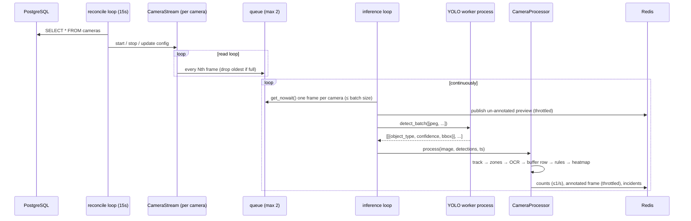

# Detection Pipeline

The pipeline is the `inference` container, entrypoint `python -m app.pipeline.runner`
([backend/app/pipeline/runner.py](../backend/app/pipeline/runner.py)). It is a
single asyncio process plus a pool of YOLO worker processes.



## Orchestrator: `Pipeline`

`Pipeline.run()` starts the `DetectionWriter`, creates the process pool, and
gathers six long-running tasks:

| Task | Function | Cadence |
|---|---|---|
| `reconcile` | `Pipeline._reconcile_loop` | every 15 s |
| `inference` | `Pipeline._inference_loop` | continuous; sleeps 50 ms when no frames |
| `alert-dispatcher` | `alerts.dispatcher.run_dispatcher` | event-driven (Redis subscription) |
| `analytics` | `analytics.jobs.run_hourly_aggregation_loop` | every 5 min |
| `nightly` | `analytics.jobs.run_nightly_loop` | 02:00 UTC daily |
| `guards` | `pipeline.guards.run_resource_guards` | every 30 s |

On shutdown (or if any task raises), the stop event is set, all streams are
stopped, tasks are cancelled, the writer flushes its buffer, the pool is shut
down, and DB connections are disposed.

### Camera reconciliation

`reconcile()` makes the running set of streams match the enabled rows in
`cameras`:

- **Removed or disabled** camera → stop the stream, cancel its task, drop its
  processor.
- **Existing** camera → push the latest `zones` and `rules` into its processor
  (`update_config`). If its stream task has finished (crashed, or a single-pass
  file finished), restart it.
- **New** camera → if under `MAX_CAMERAS_PER_NODE`, decrypt the source and start a
  `CameraStream` + `CameraProcessor`.

Only `zones` and `rules` are hot-reloaded. Changing a camera's **source, type,
`refresh_secs` or `loop_file`** on a running camera has no effect until the
stream is recreated — toggle the camera off and on (two saves ≥ 15 s apart) or
restart the inference container.

## Stream ingestion: `CameraStream`

[backend/app/ingestion/streams.py](../backend/app/ingestion/streams.py)

Each camera has one `CameraStream` running as an asyncio task. It owns a
`asyncio.Queue(maxsize=2)`.

### Drop-oldest enqueue

`_enqueue()` never blocks: if the queue is full it removes the oldest frame,
increments `isosafe_frames_dropped_total` and the camera's `frames_dropped`
health counter, then inserts the new one. Inference always sees one of the two
newest frames.

### Source types

| `type` | Reader | Pacing | Frame skip |
|---|---|---|---|
| `rtsp` | `cv2.VideoCapture(source, CAP_FFMPEG)` with `CAP_PROP_BUFFERSIZE=1`, reads in the thread executor | as fast as the camera delivers | every `PROCESS_EVERY_N_FRAMES` |
| `file` | `cv2.VideoCapture(source)` | sleeps to hit `FILE_PLAYBACK_FPS` (or native FPS), clamped 5–30 | every `PROCESS_EVERY_N_FRAMES` |
| `snapshot_url` | `httpx.AsyncClient.get`, decoded with `cv2.imdecode` | one request per `refresh_secs` (min 0.2 s), next fetch prefetched while the current frame is queued | none |

File sources loop by **reopening** the file at EOF (seeking to 0 is unreliable on
some MP4s). With `loop_file=false` the read loop returns after one pass.

### Reconnects

`run()` wraps the reader in a loop. When a reader returns (EOF, read failure,
connection refused, exception), it waits per the backoff schedule
`1, 2, 4, 8, 16, 30` seconds and tries again. The backoff index resets to 0 after
any session that delivered frames and advances after sessions that delivered
none. Each reconnect increments `reconnect_count` and
`isosafe_stream_reconnects_total`.

### Camera health

[backend/app/ingestion/health.py](../backend/app/ingestion/health.py). For every
enqueued frame `CameraHealth.record_frame()` keeps a 10-second window of
timestamps and, at most every 2 s, writes to Redis
`isosafe:camera_health:<id>` (TTL 120 s):

```json
{"last_frame_ts": 1759830000.1, "reconnect_count": 2, "fps": 8.3, "frames_dropped": 41}
```

`fps` is the **enqueue rate** (after frame skipping), not the source FPS.
`GET /api/cameras` adds `online: true` when `last_frame_ts` is under 30 s old.

## Batching and the YOLO worker pool

### Collecting a batch

`_collect_batch()` iterates cameras in dictionary (insertion) order and takes at
most **one** frame per camera, stopping at `INFERENCE_BATCH_SIZE`. With more
cameras than the batch size, the cameras at the end of the dict are visited only
when earlier cameras have empty queues; in practice queue contents refresh faster
than batches complete, so allocation is roughly fair, but a heavily loaded node
can favour earlier-added cameras. Raise `INFERENCE_BATCH_SIZE` to at least the
camera count on GPU nodes.

Before inference, each frame is published as an un-annotated preview
(throttled — see [Dashboard frames](#dashboard-frames)) and JPEG-encoded at
quality 85 for transfer to the worker process.

### Worker process

[backend/app/inference/worker.py](../backend/app/inference/worker.py)

- `init_worker(model, device, person_conf, vehicle_conf, max_dim)` runs once per
  worker process: loads `YOLO(model)`, moves it to the device, warms it up on a
  blank frame.
- `detect_batch(jpegs)` decodes each JPEG (a corrupt one becomes a 64×64 black
  frame), downsizes so the longest side ≤ `INFERENCE_MAX_DIM`, runs **one**
  `model.predict(images, conf=min(thresholds))`, and filters:

| COCO id | Class kept | Threshold applied |
|---|---|---|
| 0 | `person` | `PERSON_CONFIDENCE` |
| 2 | `car` | `VEHICLE_CONFIDENCE` |
| 3 | `motorcycle` | `VEHICLE_CONFIDENCE` |
| 5 | `bus` | `VEHICLE_CONFIDENCE` |
| 7 | `truck` | `VEHICLE_CONFIDENCE` |
| 24 | `backpack` | `VEHICLE_CONFIDENCE` |
| 28 | `suitcase` | `VEHICLE_CONFIDENCE` |

Each detection is returned as:

```json
{"object_type": "car", "confidence": 0.8123, "bbox": [0.1021, 0.4412, 0.3310, 0.7015]}
```

Box coordinates are normalized to `[0, 1]` against the resized image, which makes
them valid for the original frame too.

### Crash recovery

`_infer()` catches `BrokenProcessPool` (a worker segfaulted or was OOM-killed),
shuts the pool down, builds a new one, and retries the batch once. If the retry
also breaks, the batch yields empty detections and the next batch builds a fresh
pool. Inference latency per batch is recorded in
`isosafe_inference_latency_seconds`.

## Per-camera processing: `CameraProcessor`

[backend/app/pipeline/camera_worker.py](../backend/app/pipeline/camera_worker.py).
`process(image, detections, ts)` runs these steps in order for every inferred
frame.

### 1. Tracking

[backend/app/inference/tracker.py](../backend/app/inference/tracker.py) —
`CentroidTracker`, one per camera.

- For each detection, compute its box centroid and the distance to every
  existing track **of the same class**. Candidate pairs within
  `MAX_MATCH_DISTANCE = 0.12` (normalized) are sorted by distance and assigned
  greedily, each detection and track used at most once.
- Matched tracks get the new centroid/box, `last_seen = now`,
  `frames_missing = 0`. Unmatched detections create new tracks with the next
  integer id, and increment `session_counts[object_type]`.
- Every track appends `(ts, centroid)` to its `history` (deque, max 300).
- Unmatched existing tracks increment `frames_missing`; after more than 30
  processed frames unseen they are deleted.

`session_counts` is a running total of **unique tracks per class since the
pipeline started** (it resets on restart). It is what the dashboard shows as
"today" on camera tiles.

Track ids are per camera and per pipeline run — they restart at 1 when the
container restarts and are not globally unique. The tracker carries a
`rule_state` dict used by the rule engine for per-track timers.

### 2. Zone tagging

`zones_containing(centroid, zones)` returns the ids of every **polygon** zone
containing the track centroid (ray casting). Line zones are never "contained".
The result is stored in `detections.zone_ids`.

### 3. Licence-plate OCR

[backend/app/inference/ocr.py](../backend/app/inference/ocr.py)

Runs only for vehicle tracks (`car`, `motorcycle`, `bus`, `truck`) and only on
every `OCR_EVERY_N_FRAMES`-th processed frame of that camera.

1. Crop the vehicle box from the full-resolution frame. Skip crops smaller than
   40×20 px.
2. Run EasyOCR (English, CPU, lazily initialised once; if initialisation fails
   OCR is disabled for the life of the process) in the thread executor, serialised
   by an asyncio lock because the reader is not thread-safe.
3. Uppercase, strip non-alphanumerics, keep results matching `^[A-Z0-9]{4,10}$`
   with confidence ≥ `PLATE_CONFIDENCE`, and take the most confident.
4. **Dedup:** if the same text was already recorded on this track within 60 s,
   it's not written again.

The accepted text and confidence are stored on that frame's detection row
(`plate_text`, `plate_confidence`) and shown on the annotated dashboard frame.
OCR reads the whole vehicle crop; there is no separate plate detector, so
accuracy depends heavily on camera angle and resolution.

### 4. Detection rows

Every detection (with its track id, zones, and optional plate) is passed to
`DetectionWriter.add()`.

[backend/app/inference/writer.py](../backend/app/inference/writer.py) buffers rows
and flushes them with a single asyncpg `executemany` either every **2 seconds**
or as soon as **200 rows** accumulate. On a database error the rows are put back
into the buffer, capped at 400 rows (older surplus is dropped) so an outage can't
exhaust memory. `isosafe_detections_written_total` counts successful inserts.

Note the volume this produces: one row per detected object per processed frame.
Eight cameras at ~8 processed fps with five objects each is ~320 rows/s, about
27 M rows/day — this is why `detections` is a TimescaleDB hypertable with
retention.

### 5. Rules and incidents

`CameraRuleEngine.evaluate(tracks, now)` returns a list of `RuleFire`s; each one
is passed to `create_incident()`. Failures are logged per incident and don't
affect the frame. See [Rules, zones and profiles](rules-and-zones.md) and
[Alerts and incidents](alerts-and-incidents.md).

### 6. Heatmap

For each `person` track, the centroid is bucketed into a 32×32 grid and
`HINCRBY isosafe:heatmap:<camera> "gx:gy" 1` is pipelined to Redis (key TTL 2 h).
The hourly job persists and resets these grids
(see [Analytics](analytics-and-ai.md#heatmaps)).

### 7. Live counts and dashboard frames

- **Counts:** at most once per second per camera,
  `HSET isosafe:counts <camera_id> {"in_frame": {...}, "session": {...}, "ts": ...}`.
  `in_frame` counts current tracks by class; `session` is the tracker's
  `session_counts`.
- **Frames:** see below.

### Dashboard frames

Two code paths publish to `isosafe:frames`, sharing one throttle per camera
(`1 / clamp(DASHBOARD_MAX_FPS, 2, 30)` seconds):

1. `publish_preview()` — called by the inference loop **before** inference, for
   every source type: the raw frame, no boxes.
2. `_publish()` → `_send_frame(..., tracks)` — called **after** processing, only
   for `rtsp` and `snapshot_url` sources: the frame annotated with boxes, class,
   track id, and last plate.

Frames are resized so the longest side ≤ 960 px and JPEG-encoded at
`FRAME_JPEG_QUALITY`, then base64-encoded into the JSON message. Because the
preview resets the shared throttle just before inference, an annotated frame is
only published when inference for that frame took longer than the throttle
interval; on fast nodes most dashboard frames are therefore un-annotated
previews. File sources never publish annotated frames. See
[Known issues](known-issues.md).

## Resource guards

[backend/app/pipeline/guards.py](../backend/app/pipeline/guards.py), every 30 s:

| Guard | Condition | Action |
|---|---|---|
| Memory | RSS of the pipeline process + all children (YOLO workers) > `WORKER_MEMORY_LIMIT_MB` | Log critical, publish a `system_health` critical alert, `SystemExit(3)`. Docker's `restart: unless-stopped` brings the container back; the reconcile loop restores all cameras. |
| Disk | Free space on `MEDIA_ROOT` < `DISK_MIN_FREE_GB` | Pause snapshot writes (incidents still created, without snapshots), publish a `system_health` critical alert once. Resume when free space > 1.5 × threshold. |

Self-alerts are published directly to `isosafe:alerts` with
`camera_id: "system"`. They reach WebSocket clients, email, and webhooks, but
**are not written to the `incidents` table**.

## Video uploads

`POST /api/uploads` (operator+) streams the file to
`MEDIA_ROOT/uploads/<job_id>.<ext>`, inserts an `upload_jobs` row with status
`processing`, and inserts a camera `upload-<first 8 of job id>` of type `file`
with `loop_file=false` and no zones or rules. The reconcile loop picks it up
within 15 s and processes it like any other camera: detections are written under
that camera id and appear in Investigations and analytics.

Because the upload camera has no rules, it produces detections but no incidents
until an admin adds rules to it. The job status is never set to `done` and the
reconciler restarts finished single-pass streams; see
[Known issues](known-issues.md#uploads-are-re-processed-and-never-complete).

## Metrics emitted by the pipeline

| Metric | Type | Labels |
|---|---|---|
| `isosafe_frames_processed_total` | counter | `camera_id` |
| `isosafe_frames_dropped_total` | counter | `camera_id` |
| `isosafe_frame_queue_depth` | gauge | `camera_id` |
| `isosafe_camera_fps` | gauge | `camera_id` |
| `isosafe_stream_reconnects_total` | counter | `camera_id` |
| `isosafe_inference_latency_seconds` | histogram | — |
| `isosafe_detections_written_total` | counter | — |
| `isosafe_rule_evaluations_total` | counter | `rule_type` |
| `isosafe_incidents_total` | counter | `incident_type`, `severity` |
| `isosafe_alert_dispatch_latency_seconds` | histogram | — |

> These metrics are incremented in the **inference** process, but Prometheus only
> scrapes `/api/metrics` on the **backend** process, which has its own separate
> registry. As shipped, pipeline metrics are not visible to Prometheus. See
> [Operations › Monitoring](operations.md#monitoring).
